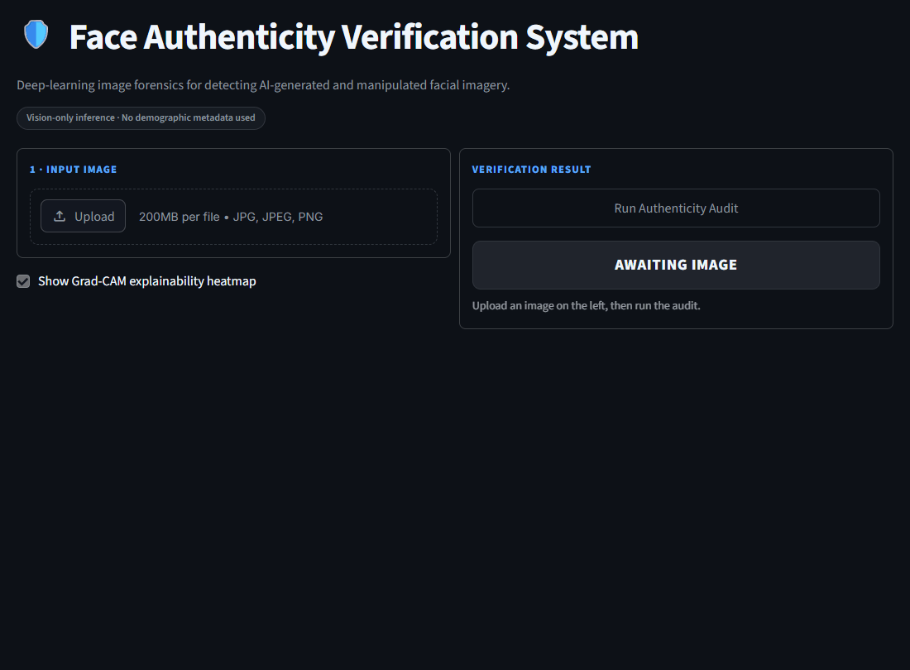
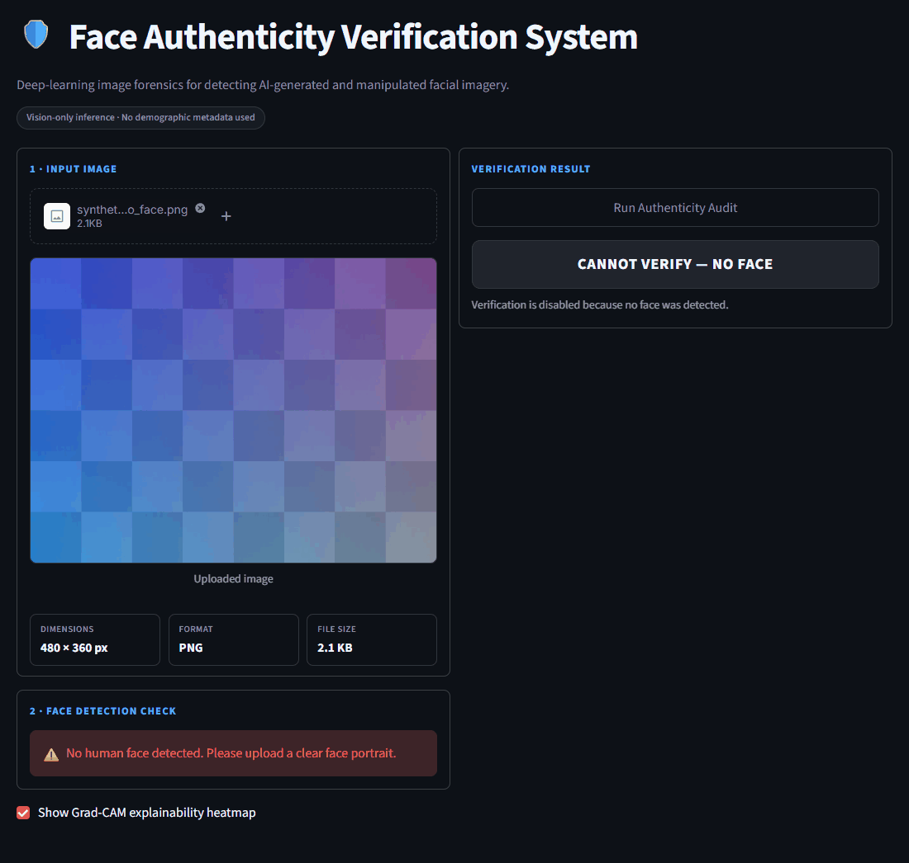
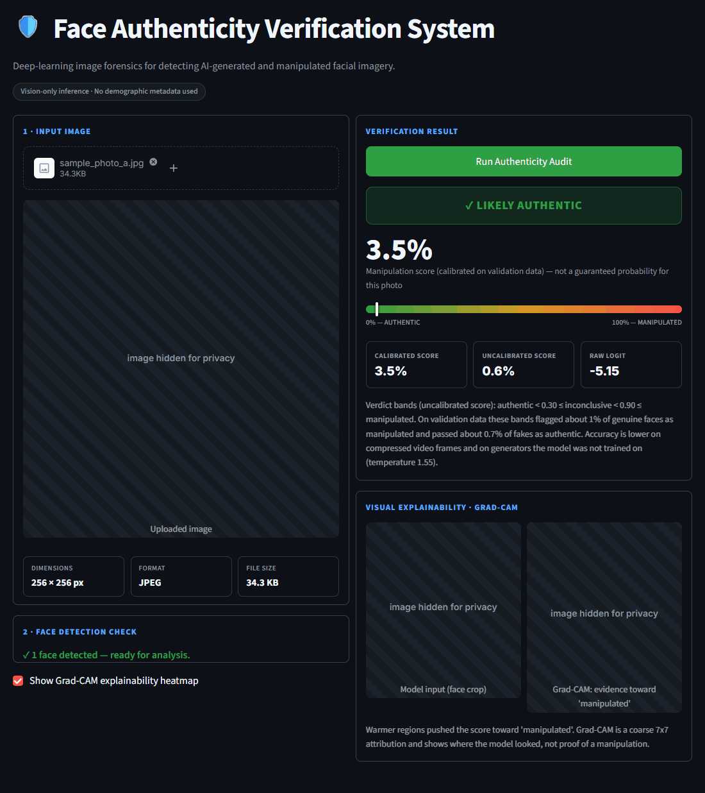
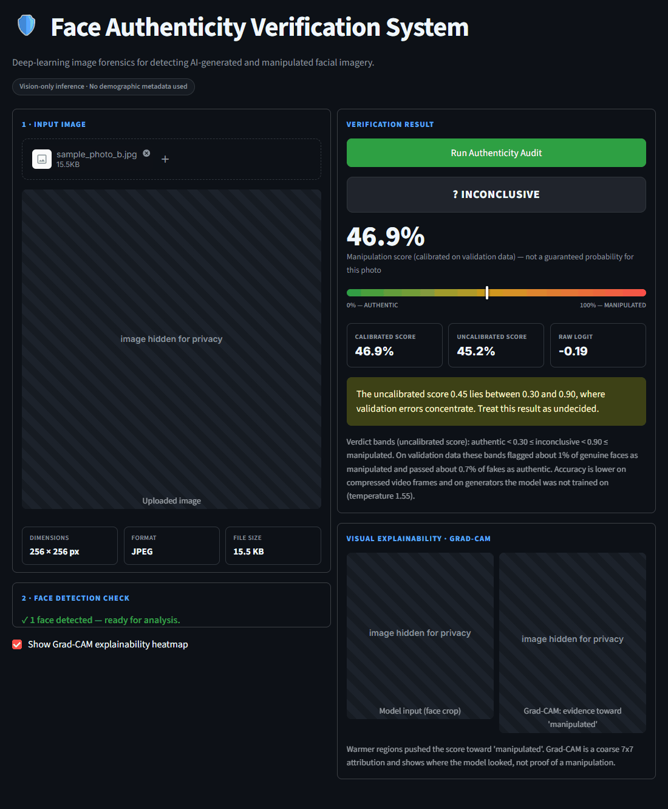
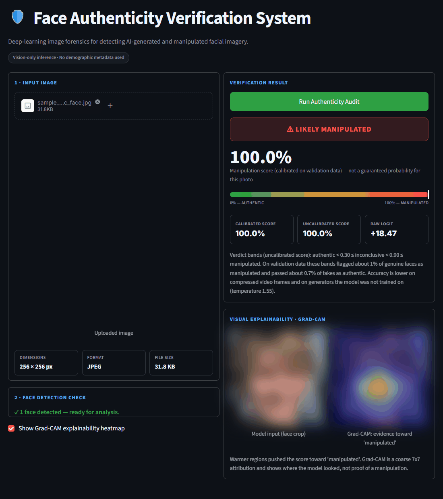
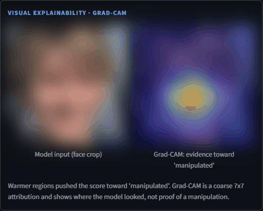
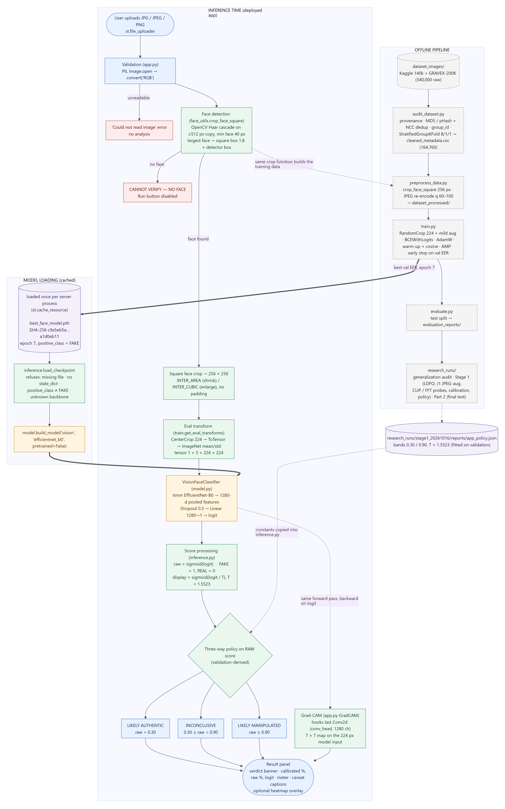
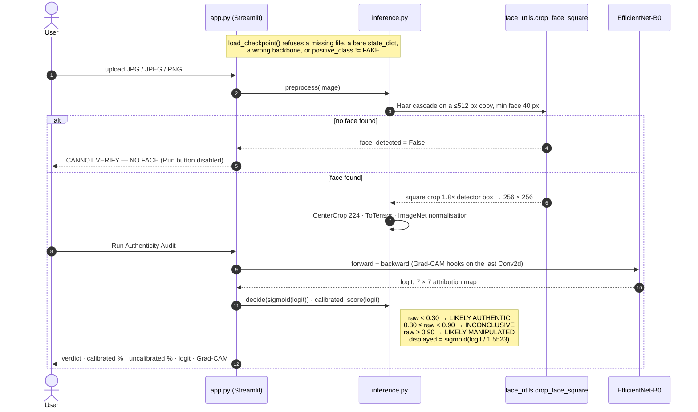
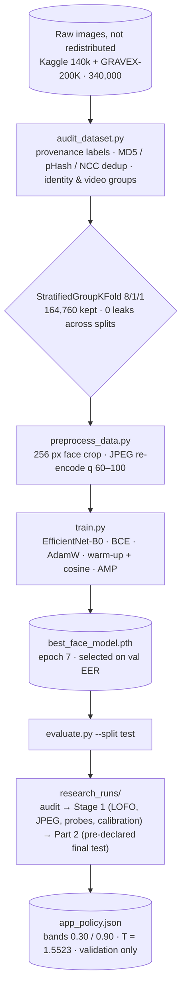
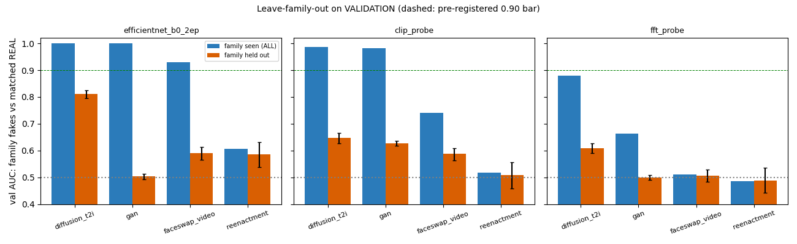

<div align="center">

# VeriFace AI

**A research project on face-image authenticity classification: an EfficientNet-B0 detector, a leakage-audited dataset pipeline, robustness and generalisation studies, Grad-CAM explainability, and a Streamlit demo with a three-way verdict.**


</div>

> [!WARNING]
> **Research project, not a forensic tool.** VeriFace AI is an experiment in classifying face images as genuine or AI-generated/manipulated and, above all, in measuring *where such a classifier fails*. Its strong headline numbers come from a test split that contains only generator families the model was trained on, and that split was examined during earlier error analysis. When an entire fake family is held out of training, detection falls to near chance. **Do not use it to make decisions about real people, content moderation, legal matters or journalism.**

---

## Table of contents

1. [Overview](#1-overview)
2. [Key features](#2-key-features)
3. [Application screenshots](#3-application-screenshots)
4. [System architecture](#4-system-architecture)
5. [Inference workflow](#5-inference-workflow)
6. [Training and evaluation workflow](#6-training-and-evaluation-workflow)
7. [Model: EfficientNet-B0](#7-model-efficientnet-b0)
8. [Dataset](#8-dataset)
9. [Training procedure](#9-training-procedure)
10. [Results](#10-results)
11. [Generalisation and robustness studies](#11-generalisation-and-robustness-studies)
12. [Failure analysis](#12-failure-analysis)
13. [Explainability: Grad-CAM](#13-explainability-grad-cam)
14. [The Streamlit application](#14-the-streamlit-application)
15. [Installation (Windows)](#15-installation-windows)
16. [Usage](#16-usage)
17. [Model checkpoint](#17-model-checkpoint)
18. [Obtaining the data](#18-obtaining-the-data)
19. [Repository structure](#19-repository-structure)
20. [Reproducibility and research integrity](#20-reproducibility-and-research-integrity)
21. [Limitations and known failure cases](#21-limitations-and-known-failure-cases)
22. [Future work](#22-future-work)
23. [Contributing, license and citation](#23-contributing-license-and-citation)
24. [Acknowledgments and references](#24-acknowledgments-and-references)

---

## 1. Overview

VeriFace AI takes a still image that contains a face. It crops the face the same way the training data was cropped, scores it with a fine-tuned EfficientNet-B0, and returns one of three verdicts: **LIKELY AUTHENTIC**, **INCONCLUSIVE** or **LIKELY MANIPULATED**. It also shows a temperature-calibrated score and a Grad-CAM heatmap.

The modelling is deliberately simple. Most of the work went into the questions around the model:

* **Is the data clean?** Images were deduplicated and checked for leakage, and the splits are group-aware.
* **Do the metrics mean what they appear to mean?** Every number in this README was re-read from a recorded artifact.
* **What happens on generators the model has never seen?** Leave-family-out experiments answer this.
* **How does compression affect it?** JPEG experiments, including a JPEG-augmentation candidate.
* **How should the app express uncertainty?** Through validation-derived verdict bands and an explicit inconclusive outcome.

| | |
|---|---|
| **Task** | Binary classification of face images: REAL = 0, FAKE = 1 (FAKE is the positive class) |
| **Selected model** | EfficientNet-B0 (timm, ImageNet init), single-logit head, epoch 7 of a run that early-stopped after epoch 10 |
| **Data** | 164,760 audited face crops from two public collections (not redistributed here) |
| **Headline (used test split)** | ROC-AUC 0.9974 · EER 2.68 % · accuracy 97.35 % @0.5 |
| **Main caveats** | No generalisation to held-out fake families · within-FF++ AUC 0.707 · performance drops under JPEG compression |
| **Full record** | [`RESEARCH.md`](RESEARCH.md) and the [A-to-Z project guide](docs/project_guide/VeriFace_AI_A_to_Z_Guide.md) ([PDF](docs/project_guide/VeriFace_AI_A_to_Z_Guide.pdf)) |

## 2. Key features

* **Leakage-aware dataset pipeline** ([`audit_dataset.py`](audit_dataset.py)):
  * Provenance-based labels.
  * MD5 and perceptual-hash deduplication, verified with normalised cross-correlation.
  * Identity and video grouping.
  * `StratifiedGroupKFold` 80/10/10 split with zero group, MD5 or near-duplicate overlap across splits.
  * A metadata "shortcut probe" that checks whether file size or resolution alone can predict the label.
* **Standardised preprocessing** ([`preprocess_data.py`](preprocess_data.py)): every image, REAL or FAKE, gets the same 256 px Haar-cascade face crop and a JPEG re-encode at a random quality between 60 and 100. Format and compression history therefore stop correlating with the label.
* **Pure-vision classifier** ([`model.py`](model.py)): no metadata enters the forward pass.
* **Resumable, memory-aware training** ([`train.py`](train.py)):
  * AMP and warm-up + cosine learning-rate schedule.
  * Early stopping on validation EER.
  * Atomic checkpoints with state fingerprints, and Windows commit-limit monitoring.
* **Evaluation protocol** ([`evaluate.py`](evaluate.py)): ROC-AUC, PR-AUC, EER, metrics at 0.5 and at the EER threshold, and a breakdown per source dataset and per generator.
* **Shared inference module** ([`inference.py`](inference.py)): bit-for-bit the same preprocessing as evaluation. It also enforces a checkpoint guard that refuses any model whose positive class is not FAKE.
* **Three-way verdict policy** with bands fitted on validation, and a temperature-scaled display score.
* **Grad-CAM** on the exact 224 px input the model saw.
* **Pre-registered experiments:** leave-family-out generalisation, a JPEG-augmentation fine-tune, CLIP and FFT linear probes, calibration and operating points. Each has a written plan, recorded results and an explicit accept/reject decision.

## 3. Application screenshots

> [!NOTE]
> These are real screenshots of the local app ([`app.py`](app.py)) running the selected checkpoint. Inputs were images from the project's **validation** split, plus one locally generated test pattern. The scores shown match the app smoke-test records in [`research_runs/app_run_check_20261016/app_tests/`](research_runs/app_run_check_20261016/app_tests/app_smoke_tests.json).
> **For privacy, photos of real people are hidden.** The StyleGAN face (synthetic, but from a third-party dataset) is heavily blurred. Upload filenames were neutralised. No dataset image is redistributed. See [`docs/assets/screenshots/README.md`](docs/assets/screenshots/README.md).

| Application interface | No face detected: input refused |
|---|---|
|  |  |
| **Likely authentic.** Genuine FFHQ photo (hidden): uncalibrated 0.6 %, calibrated 3.5 % | **Inconclusive.** Genuine FF++ broadcast frame (hidden): uncalibrated 45.2 %, inside the 0.30–0.90 band |
|  |  |
| **Likely manipulated.** StyleGAN face (blurred): raw logit +18.47 | **Grad-CAM panel** for the StyleGAN face (blurred input) |
|  |  |

The inconclusive example is not cherry-picked. Genuine FF++ broadcast frames are the model's main weakness, and 57 % of them land in the inconclusive band on the test split (§12).

## 4. System architecture

Solid boxes run inside the app. Dashed grey boxes are the offline pipeline, which the app never executes. Editable source: [`docs/diagrams/architecture.mmd`](docs/diagrams/architecture.mmd) ([SVG](docs/assets/diagrams/architecture.svg)).

<p align="center"></p>

## 5. Inference workflow

Source: [`docs/diagrams/inference_flow.mmd`](docs/diagrams/inference_flow.mmd) (rendered: [PNG](docs/assets/diagrams/inference_flow.png)).



## 6. Training and evaluation workflow

Source: [`docs/diagrams/training_evaluation.mmd`](docs/diagrams/training_evaluation.mmd) (rendered: [PNG](docs/assets/diagrams/training_evaluation.png)).



## 7. Model: EfficientNet-B0

EfficientNet-B0 (Tan & Le, 2019) is the smallest member of a family of convolutional networks whose depth, width and resolution are scaled together. It is built from mobile inverted-bottleneck (MBConv) blocks with squeeze-and-excitation. Its features come from ImageNet pre-training, and its 224 px native resolution matches the 256 px face crops used here.

| component | implementation ([`model.py`](model.py)) |
|---|---|
| backbone | `timm.create_model("efficientnet_b0", pretrained=True, num_classes=0)` → 1,280-d globally pooled features |
| head | `Dropout(0.3)` → `Linear(1280, 1)` → one raw logit; `sigmoid(logit)` is the FAKE score |
| size | 4,008,829 parameters (checkpoint ≈ 16 MB) |
| fine-tuning | stem frozen (`conv_stem` + `bn1`, 928 parameters); the rest of the backbone at 0.3 × the head learning rate |
| Grad-CAM layer | the backbone's last `Conv2d` (`conv_head`, 1,280 channels, 7 × 7 at 224 px input) |

Why this backbone: it is small enough to train for 10 epochs on a 6 GB laptop GPU in about 3 hours. It is also a standard baseline in face-forgery detection work. `model.py` also implements an Xception backbone and an RGB+FFT "dual-domain" model. Neither was used for the selected model. The dual-domain variant was skipped under a pre-registered rule, because a frequency-feature probe showed no transferable signal (§11).

## 8. Dataset

> [!IMPORTANT]
> **No images are distributed with this repository.** The data comes from third-party collections with their own licences and access terms. Many images show real people. See [§18](#18-obtaining-the-data).

**Sources.** The project uses two local collections, together 340,000 raw images, all 256 × 256 JPEG ([`audit_reports/audit_report.md`](audit_reports/audit_report.md)):

* **Kaggle "140k real-vs-fake"** (`kaggle_140k`): 70,000 FFHQ genuine faces and 70,000 StyleGAN faces.
* **GRAVEX-200K** (`gravex_200k`): 100,000 REAL and 100,000 FAKE. It is a remix of several public corpora:
  * FFHQ and StyleGAN;
  * Stable Diffusion and other text-to-image faces;
  * Celeb-DF real and synthesis frames;
  * DFDC real and fake frames;
  * FaceForensics++ originals and its Deepfakes, Face2Face, FaceShifter, FaceSwap, NeuralTextures and DeepFakeDetection manipulations;
  * a small set of web photos.

**Labels.** `label_numeric`: **REAL = 0, FAKE = 1**. Labels come from folder and filename provenance. GRAVEX's own CSVs use the opposite code (1 = REAL), so they serve only as a cross-check, which found 0 conflicts. The Stage 1 label audit found:

* 0 conflicts between labels and provenance across all 164,760 images;
* no confirmed label error among 106 confident model–label disagreements.

A few DFDC videos remain suspicious and unverifiable without DFDC's per-video metadata ([`label_integrity_report.md`](research_runs/stage1_20261016/label_integrity_report.md)).

**Cleaning.** 175,240 images were removed and **164,760 kept**:

* 4,909 pre-augmented copies;
* 3 MD5 duplicates;
* 170,328 perceptual-hash near-duplicates within generators.

Kaggle and GRAVEX share 68,037 FFHQ and 41,844 StyleGAN images as re-encodes of the same files. Cross-generator and cross-label look-alikes were not removed. They were grouped so that they always fall in the same split.

**Split.** `StratifiedGroupKFold` with 10 folds, assigned 8/1/1 and stratified by generator. Groups are connected components over identity keys, video keys and verified near-duplicates. The leakage checks found 0 shared groups, 0 shared MD5s and 0 shared verified near-duplicate pairs across splits.

| split | REAL | FAKE | total | independent groups |
|---|---:|---:|---:|---:|
| train | 65,993 | 65,691 | 131,684 | 110,982 |
| val | 8,465 | 7,976 | 16,441 | 13,980 |
| test | 8,522 | 8,113 | 16,635 | 13,991 |

**Known residual risks:**

* 49 Celeb-DF identities appear in more than one split.
* DFDC actor overlap cannot be ruled out.
* DFDC has only 4 (test) and 9 (val) independent groups.
* FF++, DFDC and Celeb-DF are video frames, so many images share a video.

**Preprocessing:**

1. `face_utils.crop_face_square`: the OpenCV Haar cascade runs on a ≤512 px copy. The largest face gives a square box of 1.8 × the detector box, capped at the image and never padded.
2. The crop is resized to 256 px.
3. Every image is re-encoded as baseline JPEG (4:2:0) at a quality drawn per image from [60, 100], so the encoding is deterministic.

A post-preprocessing probe checks that the processed files' size, quality factor and crop traces do not predict the label.

## 9. Training procedure

All values are from [`train.py`](train.py) and [`training_reports/training_summary.json`](training_reports/training_summary.json).

| setting | value |
|---|---|
| input | RandomCrop 224 of the 256 px crop; evaluation uses CenterCrop 224 |
| augmentation | horizontal flip (p 0.5) · colour jitter ±0.1, hue ±0.02 (p 0.5) · Gaussian blur σ 0.1–0.8 (p 0.2) · affine ±5°, ±3 % shift, 0.97–1.03 scale · random erasing (p 0.15). No JPEG augmentation, because preprocessing already re-encodes every image |
| loss | `BCEWithLogitsLoss` |
| optimiser | AdamW, learning rate 3e-4, weight decay 0.01; backbone at 0.3 × learning rate; stem frozen |
| schedule | 1-epoch linear warm-up, then cosine decay, stepped per batch |
| batch / precision | 16 · mixed precision (AMP) · seed 42 · 0 data-loader workers |
| selection | lowest validation EER (ties broken by validation loss); patience 3; at most 15 epochs |
| run | stopped after epoch 10; **epoch 7 selected** (val AUC 0.9974, val EER 2.62 %); 82,300 steps in 188 min |
| hardware | Windows 11, NVIDIA RTX 3060 Laptop GPU (6 GB), Python 3.13 (recorded in [`RESEARCH.md`](RESEARCH.md) §12) |

Training-time validation runs in fp16. An fp32 re-inference gives val EER 2.66 %; the difference is numerical precision (median |Δlogit| 0.02).

## 10. Results

> [!CAUTION]
> **Read before citing these numbers.** Two caveats apply:
> * **The test split is a used benchmark, not an untouched one.** Its predictions were examined during earlier error analysis, and weak subgroups were first noticed on it. Every hypothesis was then re-tested on train/val, and no model, threshold or temperature was ever fitted on test ([`RESEARCH.md` §10](RESEARCH.md)).
> * **Every generator in the test split also appears in training.** These numbers therefore measure recognition of *known* generator families, not general deepfake detection.

**Selected model, clean test split** (n = 16,635; 95 % CIs from a group bootstrap over 13,991 groups; [`test_final_summary.json`](research_runs/part2_final_20261016/reports/test_final_summary.json), [`evaluation_test_20261016_091737.json`](evaluation_reports/evaluation_test_20261016_091737.json)):

| metric | value |
|---|---|
| ROC-AUC | **0.9974** [0.9956, 0.9986] |
| PR-AUC (FAKE positive) | 0.9973 |
| EER | **2.68 %** [2.02, 3.46] at threshold 0.641 |
| accuracy @0.5 | 97.35 % [96.54, 98.06] |
| precision / recall / F1 (FAKE) @0.5 | 96.58 % / 98.05 % / 97.31 % |
| genuine images flagged FAKE @0.5 | 3.31 % (282 / 8,522) |
| fakes missed @0.5 | 1.95 % (158 / 8,113) |
| confusion @0.5 [TN, FP, FN, TP] | [8,240, 282, 158, 7,955] |
| **app policy:** genuine called MANIPULATED / fakes called AUTHENTIC | 1.03 % / 1.36 % |
| **app policy:** inconclusive share | 4.27 % (validation estimate: 4.8 %) |
| **app policy:** accuracy on decided images | 98.76 % |
| calibration (15-bin ECE) | 1.03 % raw → 0.39 % with the validation temperature |

**Per-generator performance** (clean test, @0.5; [`test_subgroups_baseline_vs_J1.csv`](research_runs/part2_final_20261016/reports/test_subgroups_baseline_vs_J1.csv)):

| generator (label) | n (groups) | correct @0.5 | app verdicts: authentic / inconclusive / manipulated |
|---|---|---:|---|
| FFHQ (REAL) | 7,091 | 99.41 % | 99.1 / 0.8 / 0.2 % |
| Celeb-DF real (REAL) | 598 (6) | 97.7 % | 96.0 / 3.7 / 0.3 % |
| DFDC real (REAL) | 230 (**4**) | 85.7 % | 83.0 / 12.6 / 4.3 % |
| **FF++ originals (REAL)** | 278 (50) | **33.5 %** | 21.6 / **57.2** / 21.2 % |
| StyleGAN (FAKE) | 5,785 | 99.69 % | 0.2 / 0.6 / 99.2 % |
| Stable Diffusion (FAKE) | 749 | 99.6 % | 0.1 / 0.8 / 99.1 % |
| Celeb-DF synthesis (FAKE) | 253 (5) | 92.1 % | 5.9 / 11.1 / 83.0 % |
| DFDC fake (FAKE) | 442 (6) | 87.1 % | 11.5 / 8.1 / 80.3 % |
| FF++ Deepfakes / FaceSwap / FaceShifter (FAKE) | 133 / 135 / 132 | 96.2 / 93.3 / 91.7 % | 42–56 % inconclusive |
| FF++ Face2Face / NeuralTextures (FAKE) | 131 / 130 | 90.8 / 82.3 % | 56 / 55 % inconclusive |
| **within-FF++ AUC** (FF++ fakes vs FF++ originals) | 962 (51) | **ROC-AUC 0.707** | — |

The DFDC and Celeb-DF rows each rest on 4–6 independent groups, so they are not reliable estimates.

## 11. Generalisation and robustness studies

Model comparisons and selection used the **validation split only**. Each study had a pre-registered plan ([`experiment_plan.md`](research_runs/stage1_20261016/experiment_plan.md), [`PREDECLARATION.md`](research_runs/part2_final_20261016/PREDECLARATION.md)).

### 11.1 Leave-family-out (LOFO): does it detect fake families it never saw?

Five EfficientNet-B0 runs (ImageNet init, 2 full epochs each, identical recipe): one control trained on everything, and four that each hold one fake family out of training. The AUC compares held-out fakes with matched genuine images on validation (FFHQ for GAN and diffusion; the video sources for face-swap and reenactment). Source: [`lofo_efficientnet_val.csv`](research_runs/stage1_20261016/reports/lofo_efficientnet_val.csv), re-verified in [`verify_lofo.csv`](research_runs/part2_final_20261016/reports/verify_lofo.csv).

| held-out family | TPR @0.5: seen → held out | AUC: seen → **held out** [95 % CI] | pre-registered verdict |
|---|---|---|---|
| diffusion / text-to-image | 99.6 % → 15.3 % | 0.9997 → **0.812** [0.796, 0.826] | partial |
| GAN (StyleGAN) | 99.3 % → 0.0 % | 0.9996 → **0.504** [0.493, 0.513] | not supported |
| face-swap (video) | 97.3 % → 19.9 % | 0.930 → **0.591** [0.566, 0.614] | not supported |
| reenactment (Face2Face, NeuralTextures) | 96.3 % → 67.8 % | 0.606 → **0.587** [0.538, 0.631] | not supported |

<p align="center"></p>

**Conclusion: the detector learns family-specific artefacts, so detection of unseen generators is not supported.** These are 2-epoch diagnostic models, so the result is a relative comparison against the same-budget control. The reenactment "TPR" reflects the FF++ source prior, not detection.

> [!NOTE]
> **Diffusion hold-out number, reconciled.** Three diffusion hold-out values appear across project documents: 0.81, 0.74 and 0.50. They come from two different experiments and two metric definitions; one of the three is a misattribution. **0.812** is the corrected Stage 1 run, measured against FFHQ genuine images. Against all validation genuine images, the same run gives 0.762. **0.74** comes from an earlier, superseded run that trained for only 1 epoch because of a sampler bug. **0.50** is the GAN hold-out result, wrongly attributed to diffusion in one request. All values were recomputed from raw predictions; see [`docs/METRIC_RECONCILIATION.md`](docs/METRIC_RECONCILIATION.md).

### 11.2 JPEG compression and the J1 candidate

**J1** is a 1-epoch fine-tune of the baseline with JPEG augmentation (quality 30–60, p = 0.5). It was compared against a matched plain fine-tune, **E0**.

**Validation EER** ([`jpeg_robustness_val.csv`](research_runs/stage1_20261016/reports/jpeg_robustness_val.csv)):

| model | clean | JPEG q50 | JPEG q35 |
|---|---:|---:|---:|
| baseline (selected) | 2.62 % | 4.59 % | 4.93 % |
| E0 (matched control) | 2.82 % | 4.92 % | 5.50 % |
| J1 (JPEG-augmented) | 2.58 % | 3.72 % | 4.30 % |

**Pre-registered criteria** at q35, measured against E0 ([`verify_handoff.json`](research_runs/part2_final_20261016/reports/verify_handoff.json)):

| criterion | required | result | met? |
|---|---|---|---|
| C1: StyleGAN-TPR drop | ≤ ½ of E0's drop | ratio 0.92 | no |
| C2: FFHQ false-positive rise | ≤ ½ of E0's rise | ratio 0.59 | no |
| C3: clean EER | ≤ E0 + 0.3 pp | 2.58 % vs 2.82 % | yes |
| C4: within-FF++ AUC | ≥ E0 − 0.02 | 0.726 vs 0.734 | yes |

**J1 was not selected.** This was declared in writing before any final test inference.

**One-shot descriptive comparison on test** (`test_baseline_vs_J1_by_arm.csv`):

| metric | baseline clean | J1 clean | baseline q50 | J1 q50 | baseline q35 | J1 q35 |
|---|---:|---:|---:|---:|---:|---:|
| ROC-AUC | 0.9974 | 0.9977 | 0.9931 | 0.9956 | 0.9894 | 0.9930 |
| EER | 2.68 % | 2.58 % | 4.40 % | 3.67 % | 5.21 % | 4.34 % |
| genuine flagged @0.5 | 3.31 % | 3.11 % | 6.64 % | 5.62 % | 6.85 % | 6.86 % |
| fakes missed @0.5 | 1.95 % | 2.03 % | 2.47 % | 2.10 % | 3.64 % | 2.45 % |

* **Where J1 is better:** under heavy compression, in aggregate. At q35, EER falls by 0.86 pp [−1.28, −0.43].
* **Where it is not:** genuine-face false positives under q35 do not improve.
* **Regressions:** J1 is worse on some subgroups (clean test, @0.5):
  * Celeb-DF genuine false positives rise from 14 to 32 of 598.
  * FF++ fakes detected fall: Face2Face 119 → 100, FaceSwap 126 → 115, NeuralTextures 107 → 94.
* **Not a real gain:** within-FF++ AUC moves only from 0.707 to 0.714. J1 shifts FF++ scores; it does not separate FF++ fakes from originals better.

The comparison is descriptive and does not overturn the pre-declared selection.

### 11.3 Other experiments

| experiment | result | decision |
|---|---|---|
| E1: source-class-balanced loss (1 epoch) | shifted the FF++ prior only; no discrimination gain | rejected |
| E2: video sources oversampled ×4 (1 epoch) | no FF++ gain | rejected |
| CLIP ViT-B/16 frozen linear probe | val AUC 0.958; LOFO held-out AUC 0.51–0.65 | negative |
| FFT radial-spectrum probe | val AUC 0.668; LOFO held-out AUC 0.49–0.61 | negative; dual-domain CNN skipped by rule |
| higher-resolution FF++ | all local FF++ frames are 256 px with faces ≈ 120 px | infeasible |

**Operating points** (validation, cross-fitted) — share of fakes missed at a fixed genuine false-positive rate:

| genuine FPR | threshold | fakes missed |
|---|---:|---:|
| 1 % | ≈ 0.90 | 6.5 % |
| 2 % | ≈ 0.79 | 3.8 % |
| 5 % | ≈ 0.28 | 0.6 % |

## 12. Failure analysis

* **FF++ broadcast frames are the main weakness.**
  * Genuine FF++ originals are flagged FAKE 66.5 % of the time at 0.5.
  * Within-FF++ AUC is 0.707 on test and 0.720 on validation.
  * The model mostly separates "FF++-looking frames" from other sources rather than FF++ fakes from FF++ originals.
  * The faces are small (≈ 120 px in 256 px frames), and every FF++ image went through heavy compression.
* **Unseen families are missed** (§11.1):
  * A held-out GAN scores at chance (AUC 0.50, 0 % detected at 0.5).
  * A new generator can pass as authentic with high confidence.
* **Compression:** test EER rises from 2.68 % to 5.21 % at JPEG q35.
* **Crop failures:** whole-frame inputs look "more fake". FF++ originals with no detected face are flagged 87.5 % of the time, against 69 % with a face crop. The app therefore refuses images in which no face is found.
* **Small, correlated subgroups:** DFDC and Celeb-DF estimates rest on 4–29 independent groups. Celeb-DF also has identities shared across splits, so its numbers are optimistic.
* **Score ≠ probability:** the temperature was fitted on validation data from the same sources. On a photo from a new camera, platform or generator, the "calibrated score" carries no guarantee.

## 13. Explainability: Grad-CAM

The app computes Grad-CAM (Selvaraju et al., 2017) on the backbone's last convolution (`conv_head`) in the same forward pass that scores the image:

* The gradient of the FAKE logit is averaged per channel and used to weight the 7 × 7 activation map.
* The map goes through a ReLU and is normalised to [0, 1].
* It is upsampled and drawn over the **exact 224 px crop the model analysed**.

**What it can show.** The heatmap shows which coarse regions increased the FAKE score.

On validation, the share of FAKE evidence inside the central 25 % face box ([`gradcam_center_share_summary_val.csv`](research_runs/stage1_20261016/reports/gradcam_center_share_summary_val.csv)):

| image group | share in face box |
|---|---:|
| StyleGAN | 0.83 |
| Stable Diffusion | 0.62 |
| FF++ original false positives | 0.37 |
| FFHQ | 0.02 |

This is consistent with no broadcast-overlay or background shortcut.

**What it cannot show.** Grad-CAM is an approximate, low-resolution (7 × 7) attribution of one model's behaviour:

* it does **not** locate a manipulation;
* it does **not** prove that an image is fake;
* it does **not** explain *which* artefact was used;
* it can look plausible even when the prediction is wrong.

The reading above is descriptive, not causal.

## 14. The Streamlit application

[`app.py`](app.py) imports all scoring logic from [`inference.py`](inference.py), so the app sees the same input as the evaluation pipeline. On 255 raw validation images, the app and the evaluation pipeline agree with Spearman 0.993.

1. **Checkpoint guard.** `load_checkpoint` refuses to start if any of these holds:
   * the file is missing;
   * it is a bare `state_dict`;
   * the backbone is not supported;
   * `positive_class` is not `"FAKE"` (a REAL-positive model would silently invert every verdict).
2. **Face-detection safeguard.** The gate uses the *same* detection as the training cropper (Haar cascade, ≤512 px copy, minimum face 40 px).
   * If no face is found, the app shows **CANNOT VERIFY — NO FACE** and disables the Run button.
   * Multiple faces trigger a warning; the largest face is analysed.
   * The Haar cascade is a cheap gate, not a face-quality check. It can miss rotated or partly visible faces.
3. **Scores.** Three numbers are shown:
   * **Uncalibrated score** = `sigmoid(logit)`. The verdict bands are applied to this value.
   * **Calibrated score** = `sigmoid(logit / T)` with T = 1.5523, fitted on validation. This is the large number on screen. It is labelled *"Manipulation score (calibrated on validation data) — not a guaranteed probability for this photo"*.
   * **Raw logit**, for transparency.
4. **Three-way verdict** ([`app_policy.json`](research_runs/stage1_20261016/reports/app_policy.json); fitted on validation, cross-fitted over groups):

   | uncalibrated score | verdict | validation behaviour |
   |---|---|---|
   | < 0.30 | **LIKELY AUTHENTIC** | 0.7 % of fakes land here |
   | 0.30 – 0.90 | **INCONCLUSIVE** | 4.8 % of all images, but 67 % (292 / 434) of the validation errors made at 0.5 |
   | ≥ 0.90 | **LIKELY MANIPULATED** | 1.0 % of genuine faces land here |

5. **Grad-CAM** (optional) is drawn on the model-input crop, with a caption stating its limits.

App tests (all pass): [`research_runs/app_run_check_20261016/app_tests/`](research_runs/app_run_check_20261016/app_tests/) and [`research_runs/part2_final_20261016/app_tests/`](research_runs/part2_final_20261016/app_tests/). They cover genuine, StyleGAN, Stable Diffusion and inconclusive cases; blank and noise inputs (refused); and four invalid checkpoints (refused).

## 15. Installation (Windows)

The project was developed and run on **Windows 11 with Python 3.13.5** and an NVIDIA RTX 3060 Laptop GPU (CUDA build of PyTorch). The app also runs on CPU. A clean install from this file has **not** been verified on a second machine; the versions in [`requirements.txt`](requirements.txt) are the ones installed on the development machine.

```powershell
git clone https://github.com/Anshu-raj-co/VeriFace-AI.git
cd VeriFace-AI

py -3.13 -m venv .venv
.\.venv\Scripts\Activate.ps1

# 1) PyTorch first: choose the build for your hardware at https://pytorch.org/get-started/locally/
#    (development machine: torch 2.14.0+cu130, torchvision 0.29.0+cu130). For CPU only:
pip install torch torchvision

# 2) Everything else
pip install -r requirements.txt
```

Notes:

* No environment variables or API keys are required.
* The face detector uses the Haar cascade bundled with `opencv-python`; nothing extra is downloaded.
* `timm` downloads ImageNet weights for EfficientNet-B0 only when **training** from scratch. The app and evaluation build the model with `pretrained=False` and load the local checkpoint.

## 16. Usage

**Quick self-checks** (no dataset or checkpoint needed):

```powershell
python model.py        # builds both model variants, checks one logit per image
python face_utils.py   # the face gate rejects a blank image
```

**Run the app** (needs `best_face_model.pth` in the project root; see §17):

```powershell
streamlit run app.py
```

**Rebuild the data pipeline** (needs the raw datasets under `dataset_images/`; see §18):

```powershell
python audit_dataset.py      # audit, dedup, group-aware split -> cleaned_metadata.csv, audit_reports/
python preprocess_data.py    # 256 px face crops + JPEG re-encode -> dataset_processed/
```

**Train and evaluate:**

```powershell
python train.py                       # defaults: 15 epochs max, batch 16, AMP, patience 3
python train.py --resume              # continue after an interruption
python evaluate.py --split val        # model development
python evaluate.py --split test       # final evaluation only; see §20
```

* `train.py` refuses to overwrite an earlier run's outputs unless you pass `--allow-overwrite`.
* On Windows, keep `--num-workers 0` unless you have spare commit memory. Each loader worker reloads the CUDA DLLs (≈ 1.5–2 GB commit each).

**Research and app test scripts** live under `research_runs/*/scripts/`. Some contain absolute paths from the development machine, and most need the full dataset and the research checkpoints. They are published as a record of exactly what was run, not as a turnkey benchmark. The commands that were run are listed in [`RESEARCH.md` §12](RESEARCH.md).

## 17. Model checkpoint

**Model weights are intentionally not included** in this repository or its releases. Neither are the selected `best_face_model.pth`, the J1 candidate, or the LOFO and audit checkpoints.

* **To run the app, train your own checkpoint** with `train.py` on data you are authorised to use. The app accepts only checkpoints that `train.py` writes: a dict with `state_dict`, `backbone`, `model_type` and `positive_class = "FAKE"`.
* **To verify a checkpoint you received from the author through an authorised channel,** compare its SHA-256 with the value below. Do not download weights from unofficial mirrors.

```text
best_face_model.pth  SHA-256  c9a5eb5ea0d082ad99b2039fb63290f6c94c28372fc2ee88c75c2837a1d0eb11
```

The candidate checkpoint hashes are in [`research_runs/stage1_20261016/data/candidate_checkpoint_hashes.sha256`](research_runs/stage1_20261016/data/candidate_checkpoint_hashes.sha256).

## 18. Obtaining the data

This repository contains **no dataset images, crops, metadata tables, or per-image prediction files**. To reproduce the pipeline:

1. **Obtain each collection from its official source, and accept its licence and terms.** Several upstream corpora restrict use to non-commercial research. Some require an access request, and they contain images of real people. Permission to *use* a dataset is not permission to *redistribute* it.
   * **Kaggle "140k Real and Fake Faces"**: 70k FFHQ + 70k StyleGAN. FFHQ images carry their own licences (see the FFHQ repository).
   * **GRAVEX-200K**: a 200k real-vs-AI face remix. Check its own licence *and* those of the corpora it includes.
   * Upstream corpora referenced by GRAVEX: [FFHQ](https://github.com/NVlabs/ffhq-dataset), [FaceForensics++](https://github.com/ondyari/FaceForensics) (access by request; terms of use), [DFDC](https://ai.meta.com/datasets/dfdc/), [Celeb-DF](https://github.com/yuezunli/celeb-deepfakeforensics) (access by request).
2. Place the collections as `audit_dataset.py` expects:
   * `dataset_images/real-vs-fake/{train,valid,test}/{real,fake}/`
   * `dataset_images/my_real_vs_ai_dataset/` with `{train,val,test}_labels.csv` and the image folders.
3. Run `audit_dataset.py`, then `preprocess_data.py`.

The original download URLs were not recorded in the project, so verify that what you download matches the counts in [`audit_reports/audit_report.md`](audit_reports/audit_report.md). If it differs, the splits and all numbers here will differ.

## 19. Repository structure

```text
VeriFace-AI/
├── app.py                    Streamlit UI (verdict, scores, Grad-CAM)
├── inference.py              shared single-image inference + verdict policy
├── face_utils.py             Haar face gate + canonical square face crop
├── model.py                  EfficientNet-B0 / Xception classifier, dual-domain variant
├── train.py                  resumable training (AMP, warm-up + cosine, early stop on val EER)
├── evaluate.py               evaluation protocol + per-generator breakdown
├── audit_dataset.py          dataset audit, dedup, group-aware split
├── preprocess_data.py        standardised face crops + JPEG re-encode
├── requirements.txt
├── RESEARCH.md               consolidated research record (primary reference)
├── audit_reports/            dataset audit summary (markdown / JSON only)
├── training_reports/         history.csv, training_summary.json
├── evaluation_reports/       original test evaluation JSON
├── research_runs/
│   ├── generalization_audit_20261016/   error analysis, E0–E2, superseded C-LOGO
│   ├── stage1_20261016/                 label audit, app fix, LOFO, J1, probes, calibration
│   ├── part2_final_20261016/            pre-declaration, final test, app tests
│   └── app_run_check_20261016/          app re-test after the score-meter fix
└── docs/
    ├── assets/screenshots/   redacted app screenshots (+ provenance README)
    ├── assets/diagrams/      rendered PNG / SVG diagrams
    ├── diagrams/             Mermaid sources + local renderer
    ├── project_guide/        A-to-Z guide (Markdown + PDF) and its build tool
    └── METRIC_RECONCILIATION.md
```

The repository includes only summary reports, configs, scripts and aggregate plots. Excluded by [`.gitignore`](.gitignore): datasets, `cleaned_metadata.csv`, checkpoints (`*.pth`), CLIP/FFT feature arrays, per-image prediction CSVs, raw logs, and plots that show dataset faces.

## 20. Reproducibility and research integrity

* **Pre-registration.** Stage 1 criteria were written before any Stage 1 result ([`experiment_plan.md`](research_runs/stage1_20261016/experiment_plan.md)). The final-test protocol was declared before test inference ([`PREDECLARATION.md`](research_runs/part2_final_20261016/PREDECLARATION.md)).
* **Selection on validation only.** No model, threshold, band or temperature was fitted on test.
* **Test-set exposure is disclosed.** The test split was evaluated after training and then examined during error analysis. **It is a used benchmark.** A clean claim needs a new, independent test set with generators and sources absent from training.
* **Corrections are recorded, not erased:**
  * The superseded C-LOGO run is kept and labelled.
  * A handoff error about J1's criteria is documented in `RESEARCH.md` §7.
  * The diffusion-AUC reconciliation is in [`docs/METRIC_RECONCILIATION.md`](docs/METRIC_RECONCILIATION.md).
* **Determinism.**
  * Seeds are fixed (42).
  * The JPEG quality for each image is derived from its id.
  * The training sampler is deterministic, and resume is fingerprint-checked.
  * The data split itself is reproducible from `audit_dataset.py`.
* **Single runs.** No seed variance was measured for the baseline.
* **Known quirks.**
  * A mid-epoch `--resume` in `train.py` shifts the augmentation random stream by one draw.
  * `train_exp.py` does not restore the JPEG-augmentation random state on resume.
  * None of the reported runs was resumed.

## 21. Limitations and known failure cases

1. **No demonstrated generalisation to unseen generators** or to new sources (§11.1). Cross-dataset evaluation has not been done.
2. **Weak on FF++-style compressed broadcast frames.** Within-FF++ AUC is 0.707, and most genuine FF++ frames are flagged or inconclusive.
3. **Compression sensitivity.** EER roughly doubles at JPEG q35.
4. **Still images and a single face only.** No video, temporal, audio or multi-face reasoning.
5. **The face gate is a Haar cascade.** It misses some real faces and refuses them, and it was not evaluated as a detector.
6. **Calibration and bands are source-specific.** The displayed score is not a probability for arbitrary photos.
7. **Some labels are unverifiable.** Suspicious DFDC videos cannot be checked without DFDC's per-video metadata.
8. **The dataset is not demographically audited** for fairness across groups of people. Performance on under-represented groups is unknown.
9. **Adversarial robustness is untested.** Simple post-processing such as resizing, filters or re-compression chains may change verdicts.

## 22. Future work

* An **independent test set** built from generators and sources absent from training (recent diffusion models, other face-swap tools), collected with identity and video metadata.
* **Multi-family hold-out training** and domain-generalisation methods, evaluated with the LOFO protocol above.
* **Higher-resolution and less-compressed** video sources, to address the FF++ weakness.
* A **better face detector** (e.g. MTCNN or MediaPipe; `detect_face` is written to make the swap easy), with face-quality gating.
* **Seed-variance** runs and confidence intervals for model-selection decisions.
* A **demographic performance audit** and documentation in the style of a model card.
* **Adversarial and post-processing robustness** tests.

## 23. Contributing, license and citation

* **Contributing:** see [`CONTRIBUTING.md`](CONTRIBUTING.md). Issues that report a failure case or a factual error in the documentation are especially welcome.
* **Security and privacy:** see [`SECURITY.md`](SECURITY.md). Please do not post images of real people in issues.
* **License:** the source code and documentation written for this project are released under the [MIT License](LICENSE). The license does **not** cover:
  * the datasets or any images derived from them;
  * third-party libraries;
  * any model weights.

  Those keep their own terms.
* **Citation:** see [`CITATION.cff`](CITATION.cff), or use GitHub's "Cite this repository" button.
* **Author:** Anshu Raj, [@Anshu-raj-co](https://github.com/Anshu-raj-co).

## 24. Acknowledgments and references

This project builds on public research and open-source software. The dataset authors and the people pictured in those datasets made this research possible.

**Methods and models:**

* M. Tan, Q. V. Le. *EfficientNet: Rethinking Model Scaling for Convolutional Neural Networks.* ICML 2019.
* R. R. Selvaraju et al. *Grad-CAM: Visual Explanations from Deep Networks via Gradient-based Localization.* ICCV 2017.
* C. Guo, G. Pleiss, Y. Sun, K. Q. Weinberger. *On Calibration of Modern Neural Networks.* ICML 2017 (temperature scaling).
* P. Viola, M. Jones. *Rapid Object Detection using a Boosted Cascade of Simple Features.* CVPR 2001 (Haar cascade).
* A. Radford et al. *Learning Transferable Visual Models From Natural Language Supervision.* ICML 2021 (CLIP, used as a probe baseline).

**Datasets and generators (upstream of the collections used):**

* T. Karras, S. Laine, T. Aila. *A Style-Based Generator Architecture for Generative Adversarial Networks.* CVPR 2019 (StyleGAN, FFHQ).
* A. Rössler et al. *FaceForensics++: Learning to Detect Manipulated Facial Images.* ICCV 2019.
* B. Dolhansky et al. *The DeepFake Detection Challenge (DFDC) Dataset.* arXiv:2006.07397, 2020.
* Y. Li et al. *Celeb-DF: A Large-scale Challenging Dataset for DeepFake Forensics.* CVPR 2020.
* R. Rombach et al. *High-Resolution Image Synthesis with Latent Diffusion Models.* CVPR 2022 (Stable Diffusion).

**Software:**

* [PyTorch](https://pytorch.org) and torchvision
* [timm](https://github.com/huggingface/pytorch-image-models) (R. Wightman)
* [OpenCV](https://opencv.org)
* [scikit-learn](https://scikit-learn.org)
* [Streamlit](https://streamlit.io)
* NumPy, pandas, SciPy, Matplotlib, Pillow
* [Mermaid](https://mermaid.js.org), for the diagrams
