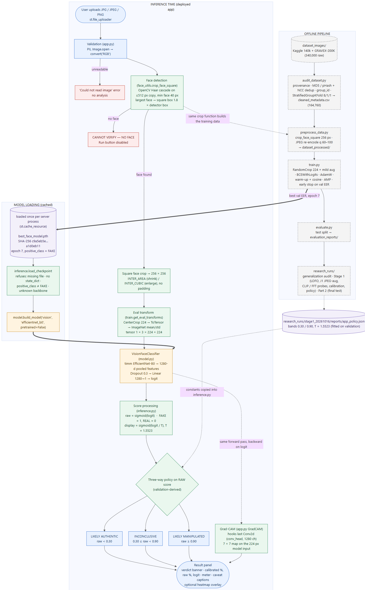
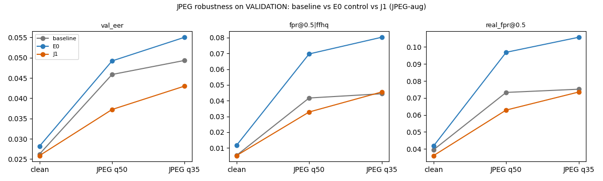

# VeriFace AI — A-to-Z Project Guide

**Face-image authenticity screening with an EfficientNet-B0 classifier, a validation-derived three-way verdict, and an honest account of where it fails.**

| item | detail |
|---|---|
| Project root | `D:\PROJECT\VeriFace AI` |
| Document date | 2026-10-16 |
| Selected model | `best_face_model.pth` — EfficientNet-B0, epoch 7, SHA-256 `c9a5eb5ea0d082ad99b2039fb63290f6c94c28372fc2ee88c75c2837a1d0eb11` |
| Primary sources | `RESEARCH.md`, `research_runs/part2_final_20261016/`, `research_runs/stage1_20261016/`, `research_runs/generalization_audit_20261016/`, `audit_reports/`, `training_reports/`, and the source files themselves |
| Status labels used | **[Implemented]** in the deployed app · **[Tested]** experiment that was run · **[Rejected]** tested and not adopted · **[Skipped]** planned but not run, with the reason · **[Future]** not done |

> **How to read the numbers in this guide.** Every metric was re-read from a project artifact, which is named next to it. Test-split numbers come from a split that earlier analyses already examined (§9.6). They describe performance on the **same sources and generator families the model was trained on**. They are **not** evidence of reliable detection of unseen generators or of real-world deepfakes.

## Contents

1. [Executive summary](#1-executive-summary)
2. [Problem statement and motivation](#2-problem-statement-and-motivation)
3. [Objectives and scope](#3-objectives-and-scope)
4. [End-to-end system architecture](#4-end-to-end-system-architecture)
5. [Complete technical pipeline](#5-complete-technical-pipeline)
6. [Dataset and label-integrity audit](#6-dataset-and-label-integrity-audit)
7. [Technology stack and justification](#7-technology-stack-and-justification)
8. [Training setup and reproducibility](#8-training-setup-and-reproducibility)
9. [Evaluation metrics and actual results](#9-evaluation-metrics-and-actual-results)
10. [Subgroup and generalization findings](#10-subgroup-and-generalization-findings)
11. [Experiments and model-selection decisions](#11-experiments-and-model-selection-decisions)
12. [Application usage](#12-application-usage)
13. [Limitations, risks and responsible interpretation](#13-limitations-risks-and-responsible-interpretation)
14. [Future roadmap](#14-future-roadmap)
15. [Architecture, folder structure and code map](#15-architecture-folder-structure-and-code-map)
16. [Interview preparation](#16-interview-preparation)
17. [Appendix: verification record for this guide](#17-appendix-verification-record-for-this-guide)

## 1. Executive summary

### What VeriFace AI is

VeriFace AI is a local web application and research codebase. It estimates whether a facial photograph is a **genuine camera image** (REAL = 0) or **AI-generated / digitally manipulated** (FAKE = 1, the positive class).

A user uploads a JPG or PNG. The app then:

1. Finds the face with the same cropper that built the training data.
2. Runs a fine-tuned **EfficientNet-B0** classifier.
3. Returns one of three verdicts:
   - **LIKELY AUTHENTIC**
   - **INCONCLUSIVE**
   - **LIKELY MANIPULATED**

The verdict comes with a temperature-scaled model score and an optional **Grad-CAM** heatmap of the image regions that pushed the score toward "manipulated".

### The problem it addresses

Realistic synthetic faces are now easy to produce. Examples include GAN portraits, diffusion "photos", face swaps and facial reenactment. People who need to judge whether a profile photo or a news frame is genuine often have no quick, explainable screening tool.

### Who might use it, and why

- **Analysts or moderators**, for a first-pass screen that triages which images deserve expert forensic review.
- **Students and engineers**, as a worked example of an end-to-end ML system with honest evaluation.

The project is a research prototype. It is not a forensic authority, and §13 explains why.

### What has actually been implemented

| component | status |
|---|---|
| Dataset audit: provenance, MD5/pHash deduplication, identity/video grouping, leak-free 8/1/1 split | **[Implemented]** `audit_dataset.py` |
| Standardised preprocessing: 256 px face crop plus a JPEG re-encode for every image | **[Implemented]** `preprocess_data.py`, `face_utils.py` |
| EfficientNet-B0 training: AMP, discriminative LR, early stopping on validation EER, resumable checkpoints | **[Implemented]** `train.py`, `model.py` |
| Evaluation: AUC, PR-AUC, EER, thresholded metrics, per-generator breakdown | **[Implemented]** `evaluate.py` |
| Inference module that reproduces the evaluation pipeline exactly | **[Implemented]** `inference.py` |
| Streamlit app: face gate, three-way verdict, calibrated score, Grad-CAM | **[Implemented]** `app.py` |
| Generalisation audit, leave-family-out (LOFO) study, label audit, JPEG robustness, CLIP and FFT probes | **[Tested]** `research_runs/` |

### Selected model and current performance

**Selected model:** `best_face_model.pth`, the original baseline.

Clean test split, 16,635 images (`research_runs/part2_final_20261016/reports/test_final_summary.json`):

- **Threshold-free:**
  - ROC-AUC **0.9974** (95% CI 0.9956–0.9986)
  - PR-AUC 0.9973
  - EER **2.68%** (2.02–3.46%)
- **At threshold 0.5:** accuracy **97.35%**, precision 96.58%, recall 98.05%, F1 97.31%.
- **App three-way policy:**
  - 1.03% of genuine images are called manipulated.
  - 1.36% of fakes are called authentic.
  - 4.27% of images are left inconclusive.
  - Among images that receive a verdict, **98.76%** are correct.

### Main research finding

The model is very accurate **on the generator families it was trained on**. It does **not** generalise to families it has never seen. When a whole family is held out of training, held-out fakes are detected at these AUCs (§10.2):

| held-out family | AUC |
|---|---|
| StyleGAN | ≈ 0.50, i.e. chance |
| Face-swap video | 0.59 |
| Reenactment | 0.59 |
| Diffusion / text-to-image | 0.81 |

The model also struggles with genuine **FaceForensics++ (FF++) broadcast frames**. At threshold 0.5 it flags 66.5% of them as fake, and its within-FF++ AUC is only 0.707.

### Main limitations

- No unseen-generator generalisation.
- FF++ false positives.
- Unresolved DFDC label uncertainty.
- A test split that was already examined during earlier analyses.
- Sensitivity to heavy JPEG compression.
- Dependence on a simple Haar-cascade face detector.

## 2. Problem statement and motivation

### 2.1 Real versus manipulated facial images

In this project, a **genuine** image is a photograph of a real person: an FFHQ portrait, a web photo, or a frame from an unedited video (Celeb-DF real, DFDC real, FF++ original). A **manipulated** image falls into one of four families:

| family | how it is made | examples in the data |
|---|---|---|
| **GAN synthesis** | the whole face is generated from noise; the person does not exist | StyleGAN |
| **Diffusion / text-to-image** | the whole image is generated from a text prompt | Stable Diffusion, `text_to_image_unknown`, `unattributed_ai` |
| **Face swap** | a real video's face is replaced with another identity | FF++ Deepfakes, FaceSwap, FaceShifter, DeepFakeDetection; Celeb-DF synthesis; DFDC fakes |
| **Reenactment** | the original face is kept but its expression or mouth is driven by another actor | FF++ Face2Face, NeuralTextures |

### 2.2 Why deepfake detection is difficult

- **The signal can be tiny.** The Stage 1 pixel check found that FF++ manipulations change a median of only **≈ 5–7% of the 256 px frame**. NeuralTextures changes as little as 0.5% (`research_runs/stage1_20261016/label_integrity_report.md` §2). The face itself is only about 120 px wide in these frames.
- **Compression destroys evidence.** Video frames are re-compressed, and JPEG removes exactly the high-frequency traces that generators leave. In this project the test EER rises from 2.68% on clean images to 5.21% at JPEG quality 35 (§9.5).
- **Shortcuts are easy to learn.** If fakes and reals differ in resolution, file size, JPEG tables or framing, a classifier learns those differences instead of manipulation evidence. Sections 5.3 and 6 describe how the data pipeline removes these shortcuts.
- **Generators keep changing.** Every new generator has its own artefacts. A detector that has learned one family's fingerprint can be completely blind to another.

### 2.3 Familiar versus unseen generators

A **familiar** generator contributed images to the training split. For example, StyleGAN faces appear in train, validation and test. An **unseen** generator contributed no training images at all.

Standard random or grouped splits put every generator in every split. They therefore measure only familiar-generator performance. The **leave-family-out (LOFO)** experiment (§10.2) is the project's only direct measurement of unseen-family performance, and it is negative.

### 2.4 Why accuracy alone is insufficient

1. **Accuracy depends on the class mix.** Accuracy at 0.5 mixes two different errors: genuine images wrongly accused (false positives) and fakes missed (false negatives). Their costs differ — accusing a real person's photo is serious — so the guide reports both separately.
2. **Thresholds are arbitrary.** ROC-AUC and EER describe ranking quality at every threshold. Accuracy describes only one threshold.
3. **Aggregate numbers hide subgroups.** The test set is dominated by FFHQ (7,091) and StyleGAN (5,785) images, which are easy. A 97% aggregate accuracy coexists with 66.5% of FF++ originals being flagged (§10.1).
4. **Frames are not independent.** Hundreds of frames can come from one video, so per-frame counts overstate the sample size. Confidence intervals are therefore computed by resampling **groups**, not images.
5. **Same-distribution accuracy says nothing about new generators** (§10.2).

## 3. Objectives and scope

### 3.1 Objectives

1. Build a **leak-free** dataset: no identity, video, or near-duplicate shared across train/val/test.
2. Train an image-only classifier, with no metadata inputs, that separates genuine from manipulated faces on the available sources.
3. Deploy it in an app whose preprocessing is **identical** to evaluation, with explicit uncertainty handling.
4. Measure honestly where it fails: subgroups, compression, unseen families, label noise.
5. Select the deployed model using **pre-registered** criteria rather than by inspecting test results.

### 3.2 Scope

- **In scope:** still images containing a face; the two local collections, Kaggle "140k real-vs-fake" and GRAVEX-200K (§6).
- **Out of scope:** video-level detection (temporal cues), audio, multi-face reasoning, identity verification, provenance or watermark checking, and robustness to deliberate adversarial attack.

### 3.3 Implemented vs experimental vs skipped vs future

| item | status | where |
|---|---|---|
| Streamlit app, inference module, EfficientNet-B0 baseline | **[Implemented]** | `app.py`, `inference.py`, `model.py`, `best_face_model.pth` |
| Three-way verdict bands and temperature scaling (validation-fitted) | **[Implemented]** | `inference.py`, `research_runs/stage1_20261016/reports/app_policy.json` |
| Grad-CAM heatmap | **[Implemented]** | `app.py` (`GradCAM`) |
| Dual-domain RGB+FFT model class | **code exists, never trained for deployment** | `model.py` (`DualDomainVisionClassifier`) |
| Xception backbone option | **code option only, never trained** | `model.py` `valid_backbones` |
| E0 / E1 / E2 fine-tunes (control, source-class-balanced loss, video sources ×4) | **[Tested] [Rejected]** | `research_runs/generalization_audit_20261016/` |
| Leave-family-out (LOFO) × 4 + control | **[Tested]** (diagnostic) | `research_runs/stage1_20261016/experiments/LOFO_*` |
| J1 JPEG-augmentation fine-tune | **[Tested] [Rejected]** — failed pre-registered criteria | `research_runs/stage1_20261016/experiments/J1_jpeg_aug/` |
| CLIP ViT-B/16 linear probe | **[Tested] [Rejected]** | `research_runs/stage1_20261016/experiments/clip_probe/` |
| FFT radial-spectrum probe | **[Tested] [Rejected]** | `research_runs/stage1_20261016/experiments/fft_probe/` |
| Dual-domain CNN training | **[Skipped]** by pre-registered rule (FFT probe did not transfer) | `STAGE1_REPORT.md` §4 |
| CLIP ViT-L/14 | **[Skipped]** (1.6 GiB download, ≈ 1 h GPU; B/16 clearly negative) | `STAGE1_REPORT.md` |
| Higher-resolution FF++ crops | **[Skipped] — infeasible** (all FF++ frames are 256 px; no source videos) | `STAGE1_REPORT.md` |
| Independent unseen-generator test set, DFDC metadata, seed variance | **[Future]** | §14 |

## 4. End-to-end system architecture



*Figure 1. Editable source: `docs/project_guide/architecture.mmd` (Mermaid); rendered as `architecture.svg` and `architecture.png`. Solid boxes run at inference time. Dashed grey boxes run offline only and are never executed by the app. CLIP, FFT and the J1 checkpoint do not appear on the inference path because the app does not use them.*

### 4.1 Components on the inference path

| # | component | code | input → output | why it exists |
|---|---|---|---|---|
| 1 | **Upload** | `app.py` `st.file_uploader(type=["jpg","jpeg","png"])` | user file → in-memory file | restricts input to the image formats the pipeline handles |
| 2 | **Validation** | `app.py`: `Image.open(...)`, `.convert("RGB")` | bytes → PIL RGB image, or the error "Could not read image" | converts grayscale, RGBA, palette and 16-bit images to 3-channel RGB; refuses corrupt files without crashing |
| 3 | **Face detection** | `face_utils.crop_face_square` → `detect_face` | RGB image → largest face box (or none) | OpenCV Haar cascade on a copy downscaled to ≤ 512 px; minimum face 40 px; histogram-equalised grayscale |
| 4 | **Face gate** | `app.py` (`face_check`) | detection result → enable or disable "Run Authenticity Audit" | when no face is found the app shows **CANNOT VERIFY — NO FACE** and gives no verdict, because a face-authenticity score for a non-face image would be meaningless |
| 5 | **Square crop** | `crop_face_square` | face box → 256 × 256 RGB | box = 1.8 × the detector box, capped at the shorter image side and shifted inside the image (no padding); `INTER_AREA` when shrinking, `INTER_CUBIC` when enlarging. **Same function `preprocess_data.py` used for training data** |
| 6 | **Eval transform** | `train.get_eval_transforms()` via `inference.preprocess` | 256 crop → tensor 1 × 3 × 224 × 224 | CenterCrop 224 (no resampling), ToTensor, ImageNet mean/std. Identical to `evaluate.py` |
| 7 | **Model** | `model.VisionFaceClassifier` | tensor → one logit | timm EfficientNet-B0 (pooled 1280-d features) → Dropout 0.3 → Linear(1280 → 1) |
| 8 | **Score processing** | `inference.py` | logit → raw score, display score | raw = sigmoid(logit) = model score for FAKE; display = sigmoid(logit / T), T = 1.5523 |
| 9 | **Three-way verdict** | `inference.decide(raw)` | raw score → verdict | < 0.30 LIKELY AUTHENTIC; ≥ 0.90 LIKELY MANIPULATED; otherwise INCONCLUSIVE. **Decided on the raw score**; bands fitted on validation |
| 10 | **Grad-CAM** | `app.py` `GradCAM` | the same forward pass → 7 × 7 heatmap | hooks the last Conv2d (`conv_head`, 1280 channels), back-propagates the logit, and overlays the map on the exact 224 px model input |
| 11 | **Result panel** | `app.py` | verdict, scores, heatmap → UI | banner, calibrated %, uncalibrated %, raw logit, meter, caveat captions |

**Model loading** happens once per server process (`@st.cache_resource`). `inference.load_checkpoint(best_face_model.pth)` refuses:

- a missing file;
- a checkpoint that is not a dict with `state_dict`;
- `positive_class` ≠ `"FAKE"`;
- an unknown backbone or model type.

It then calls `model.build_model("vision", "efficientnet_b0", pretrained=False)`, so no internet download is needed at run time. In the app, a single forward pass with gradients enabled produces both the logit used for the verdict and the Grad-CAM map. The app therefore explains exactly the prediction it shows.

### 4.2 Offline components (training and research time)

| component | role |
|---|---|
| `dataset_images/` | 340,000 raw images (two collections) plus label CSVs |
| `audit_dataset.py` | provenance, deduplication, grouping, StratifiedGroupKFold split → `cleaned_metadata.csv`, `audit_reports/` |
| `preprocess_data.py` | crop + JPEG re-encode → `dataset_processed/` (164,760 files) |
| `train.py` | trains, selects on validation EER → `best_face_model.pth`, `last_checkpoint.pth`, `training_reports/` |
| `evaluate.py` | test-split evaluation → `evaluation_reports/` |
| `research_runs/` | audits and experiments; Stage 1 produced `app_policy.json`, whose constants are copied into `inference.py` |

### 4.3 Module boundaries and why the design is structured this way

- **`inference.py` is the single source of truth for inference.** The original `app.py` resized the whole upload to 224 px without a face crop, so the app never saw what the model had been evaluated on. Stage 1 moved loading, preprocessing, scoring and the verdict into `inference.py`, which re-uses `face_utils.crop_face_square` and `train.get_eval_transforms`. The UI and the tests now call the same functions, so they cannot drift apart. This guide's verification (§17) confirms the app tensor is bit-identical to an independently built evaluation transform on 51 of 51 validation images.
- **`model.build_model` maps a checkpoint's `model_type` to a class** in one place, shared by `train.py`, `evaluate.py` and `inference.py`.
- **The checkpoint carries its own metadata** (`positive_class`, `backbone`, `model_type`, `epoch`, `input_size`, `config`, `val_metrics`). A checkpoint trained with the opposite label convention is refused instead of silently inverting every verdict.
- **`FaceImageDataset` reads only the image path and the label.** Demographic or quality metadata columns can never enter the forward pass (`model.py` docstring); this is a guard against shortcut learning.
- **Research code lives in dated folders under `research_runs/`.** It never overwrites the deployed checkpoint or root reports.

## 5. Complete technical pipeline

Each stage below lists its **purpose**, **inputs → outputs**, and **failure modes**.

### 5.1 Dataset ingestion and metadata

- **Purpose:** inventory every raw file with its source, generator and label.
- **Input:** `dataset_images/real-vs-fake/{train,valid,test}/{real,fake}` (Kaggle 140k) and `dataset_images/my_real_vs_ai_dataset/` (GRAVEX-200K with `train/val/test_labels.csv`).
- **Output:** a per-image index (`audit_reports/image_index.parquet`) with MD5, size, JPEG luma quantisation and a 64-bit DCT pHash.
- **Failure modes:**
  - Generator attribution comes from file and folder names, so it is only as good as the upstream naming.
  - `download_images.py` is an earlier downloader. It references `AI_Classification-Project.csv`, which is not in the repository, and it is not part of the verified pipeline.

### 5.2 Label convention: REAL = 0, FAKE = 1

FAKE is the positive class everywhere, and sigmoid(logit) is the model score for FAKE. This is enforced at several points:

- `label_numeric` in `cleaned_metadata.csv`: verified REAL ↔ 0 and FAKE ↔ 1 on all 164,760 rows.
- `FaceImageDataset`.
- `positive_class: "FAKE"` in the checkpoint, checked by `inference.load_checkpoint`.
- `evaluate.py`.
- The Grad-CAM target, which is the FAKE logit.

GRAVEX's own CSV uses the opposite code (REAL = 1). The audit therefore derives labels from folders and does not use the CSV codes; it found 0 folder-vs-CSV conflicts.

### 5.3 Data auditing and preprocessing

**Audit** (`audit_dataset.py` → `audit_reports/audit_report.md`):

1. **Unreadable files:** 0.
2. **Pre-augmented copies:** 4,909 GRAVEX `augmented_copy` images, dropped by provenance because pHash cannot see flips or crops.
3. **Exact duplicates:** 3 MD5 duplicates removed; 0 MD5 label conflicts.
4. **Near duplicates:** pHash Hamming ≤ 4. 170,328 near-duplicates were removed within generators. Kaggle and GRAVEX share 68,037 FFHQ and 41,844 StyleGAN files that are re-encodes of the same images.
5. **Grouping:** pHash edges between different identity groups are trusted only if the normalised cross-correlation on 64 × 64 grayscale is ≥ 0.95. That verified 69,292 edges and rejected 178,595 as collisions.
6. **Result:** 175,240 of 340,000 removed; **164,760 kept**.

**Shortcut probe:** classifiers trained on width, height, file size, aspect ratio and the JPEG quantisation table reach only ROC-AUC 0.55–0.61, near chance. Simple file metadata therefore does not reveal the label.

**Preprocessing** (`preprocess_data.py` → `audit_reports/preprocess_report.json`):

- Every image goes through `crop_face_square` (256 px).
- Every image is then **re-encoded as JPEG at a quality drawn uniformly from 60–100**, deterministic per `image_id`, with 4:2:0 chroma and no EXIF.
- Result: 164,760 processed, 0 failures.
- **Why:** the raw collections differed in compression. FFHQ and StyleGAN had a median luma quantiser of 5.77; all other sources had 29.03. Re-encoding every image (REAL and FAKE) removes compression history as a label shortcut.
- **Failure modes:**
  - The face is not detected for some frames; for example 89.6% detection on DFDC real vs 96% on Celeb-DF real. Those images fall back to a centred square.
  - The JPEG re-encode also suppresses frequency fingerprints. This is one reason the FFT probe failed (§11).

### 5.4 Face detection and cropping

`face_utils.crop_face_square` works as follows:

1. Run a Haar cascade (`haarcascade_frontalface_default.xml`, shipped with OpenCV) on a copy scaled to ≤ 512 px, with minimum face 40 px, `scaleFactor` 1.1 and `minNeighbors` 5.
2. Take the largest detection and centre a square of side 1.8 × the box on it, capped at min(W, H) and shifted inside the image.
3. If there is no face, use a centred square of side min(W, H).
4. Resize to 256 px.

- **Failure modes:**
  - Haar cascades miss profile, occluded, very small or rotated faces.
  - They can fire on face-like textures.
  - With several faces, only the largest is analysed; the app warns about this.
- The Stage 1 Grad-CAM study found that FF++ originals with **no** detected face are flagged 87.5% of the time vs 69% with a face crop. That evidence is why the app refuses no-face images instead of scoring a centre crop.

### 5.5 Train / validation / test split and leakage checks

- **Method:** `StratifiedGroupKFold` with 10 folds → 8/1/1 to train/val/test, stratified on label, grouped on `group_id`.
- **`group_id`** is a connected component over identity keys, video keys and verified near-duplicate edges. There are 138,953 groups; the largest has 474 images.
- **Verified leakage counts:** 0 shared groups, 0 shared MD5s, 0 verified near-duplicate pairs across splits.

| split | REAL | FAKE | total |
|---|---:|---:|---:|
| train | 65,993 | 65,691 | 131,684 |
| val | 8,465 | 7,976 | 16,441 |
| test | 8,522 | 8,113 | 16,635 |

**Residual risks** (§6.5):

- 49 Celeb-DF identities appear in more than one split.
- DFDC actor overlap cannot be excluded.
- DFDC val/test have only 9 and 4 independent groups.

### 5.6 Model architecture and transfer learning

- **Backbone:** `timm.create_model("efficientnet_b0", pretrained=True, num_classes=0)`, initialised from ImageNet weights at training time. It outputs a 1280-d global-average-pooled embedding.
- **Head:** `Dropout(0.3)` → `Linear(1280, 1)`, giving one raw logit (no sigmoid in the model; `BCEWithLogitsLoss` applies it).
- **Size:** 4,008,829 parameters; the checkpoint file is 16.3 MB (16,336,751 bytes).
- **Transfer learning:** discriminative learning rates via `model.group_params_for_discriminative_lr`.
  - The stem (`conv_stem`, `bn1`) is **frozen** to keep generic ImageNet edge/texture filters.
  - The rest of the backbone trains at **0.3 ×** the head LR.
  - The head trains at the full LR.

### 5.7 Training configuration

All values are from `training_reports/training_summary.json` and `train.py`.

| setting | value |
|---|---|
| loss | `BCEWithLogitsLoss` (no class weighting; the classes are near-balanced) |
| optimiser | AdamW, LR 3e-4, weight decay 0.01 |
| schedule | 1-epoch linear warm-up → cosine decay, stepped per batch |
| batch size / epochs | 16 / max 15 |
| sampler | `EpochShuffleSampler`: deterministic per-epoch shuffle seeded by 42 + epoch |
| mixed precision | AMP fp16 autocast + `GradScaler` on CUDA; `cudnn.benchmark` on; no `channels_last` (≈ 9× slower on this build) |
| data loading | `num_workers 0` (Windows commit-memory limit, §8.2) |
| train augmentation | RandomCrop 224 of the 256 crop; horizontal flip; ColorJitter (±0.1, hue 0.02) p 0.5; GaussianBlur k3 σ 0.1–0.8 p 0.2; RandomAffine (±5°, ±3% shift, 0.97–1.03 scale); RandomErasing p 0.15 (1–3% area). Kept mild so that high-frequency artefacts survive |
| eval transform | CenterCrop 224, ToTensor, ImageNet normalisation |
| model selection | lowest **validation EER** (ties: lower validation loss) |
| early stopping | patience 3 epochs on validation EER |
| checkpointing | atomic `last_checkpoint.pth` every 500 steps, before validation and after each epoch; `--resume` refuses if locked config keys or data fingerprints changed |
| safety | stops cleanly with exit code 3 if available Windows commit memory falls below 1 GB |

**Run outcome** (`training_reports/history.csv`):

- 10 epochs, 82,300 steps, 188 minutes.
- Best validation EER at **epoch 7** (2.62%, AUC 0.9974).
- Epochs 8–10 did not improve, so early stopping ended the run.

| epoch | train loss | train acc | val loss | val AUC | val EER |
|---:|---:|---:|---:|---:|---:|
| 1 | 0.319 | 84.6% | 0.145 | 0.9876 | 6.26% |
| 4 | 0.068 | 97.2% | 0.106 | 0.9956 | 3.87% |
| **7** | **0.041** | **98.3%** | **0.071** | **0.9974** | **2.62%** |
| 10 | 0.025 | 98.9% | 0.082 | 0.9974 | 2.79% |

Training accuracy is measured on augmented training batches. It is **not** comparable to validation or test numbers.

### 5.8 Validation, threshold selection and calibration

All of these were fitted on **validation only** and never on test:

- **Decision bands** (`research_runs/stage1_20261016/reports/app_policy.json`; cross-fitted over validation groups):
  - raw score < 0.30 → authentic;
  - raw score ≥ 0.90 → manipulated;
  - otherwise inconclusive.
  - On validation this called 1.0% of genuine faces manipulated, 0.7% of fakes authentic, and left 4.8% inconclusive.
- **Temperature scaling:** a single scalar T = 1.5523 minimises validation log-loss. Validation ECE fell from 1.05% to 0.67% (cross-fitted).
  - T changes only the displayed score; the verdict uses the raw score.
  - At the band edges the displayed score is 36.7% (raw 0.30) and 80.5% (raw 0.90). A displayed "80%" can therefore still be INCONCLUSIVE.
- **fp16 vs fp32:** training-time validation runs in fp16 autocast (EER 2.62%); fp32 re-inference gives 2.66%. Median |Δlogit| is 0.02, and 1 of 16,441 decisions at 0.5 changes. This is precision only.

### 5.9 Inference and final verdict

`inference.predict(model, image)` returns:

- `logit`, `raw_score_fake`, `calibrated_score_fake` and `verdict`;
- `crop_info`: face detected, number of faces, crop box, upscaled;
- the 224 px `model_view` and the 256 px `face_crop`.

`app.py` adds the face gate, the UI and Grad-CAM. **Important for programmatic use:** `predict()` itself does **not** refuse no-face images. It scores a centre crop and reports `face_detected = False`. Callers must check that flag, as the app does. In this guide's checks, a blank image scored 0.00 and a no-face panorama scored 0.98 through `predict()` directly; the app correctly refused both kinds of input.

### 5.10 Grad-CAM and error analysis

- **Grad-CAM in the app:**
  - Forward and backward hooks on the last `nn.Conv2d` of the backbone (`conv_head`, 1280 channels, 7 × 7 spatial).
  - Weights = spatially averaged gradients of the FAKE logit; map = ReLU(Σ weights × activations), normalised to [0, 1].
  - Upsampled bilinearly and blended (jet colormap, α 0.45) onto the 224 px model input.
  - Verified (§17): same logit as `predict()`, a finite 7 × 7 map, hooks removed after use, overlay size 224 × 224.
- **Error analysis:** done in the generalisation audit and in Stage 1.
  - Validation Grad-CAM share inside the central face box: StyleGAN 0.83; FF++ original false positives 0.37; FFHQ 0.02.
  - Grid image: `research_runs/stage1_20261016/plots/gradcam_val_examples.png` (not reproduced here because it shows faces of real people from the datasets).
  - No broadcast-overlay or background shortcut was found. This reading is descriptive, not causal; Grad-CAM at 7 × 7 is coarse and shows where the model looked, not proof of manipulation.

## 6. Dataset and label-integrity audit

### 6.1 Verified dataset structure

| collection | raw images | contents |
|---|---:|---|
| `kaggle_140k` (`dataset_images/real-vs-fake/`) | 140,000 | 70,000 FFHQ real + 70,000 StyleGAN fake, all 256 × 256 JPEG |
| `gravex_200k` (`dataset_images/my_real_vs_ai_dataset/`) | 200,000 | 100,000 REAL + 100,000 FAKE from FFHQ, StyleGAN, Stable Diffusion, text-to-image, unattributed AI, web photos, Celeb-DF, DFDC, FF++ |

After cleaning: **164,760 face crops** in `dataset_processed/{train,val,test}/{real,fake}/` (164,760 files verified on disk).

Test-split composition by generator:

| genuine (REAL) | n | manipulated (FAKE) | n |
|---|---:|---|---:|
| FFHQ | 7,091 | StyleGAN | 5,785 |
| Celeb-DF real | 598 | Stable Diffusion | 749 |
| Celeb-DF YouTube real | 252 | text_to_image_unknown | 50 |
| DFDC real | 230 | unattributed_ai | 150 |
| FF++ originals | 278 | Celeb-DF synthesis | 253 |
| web photo | 73 | DFDC fake | 442 |
| | | FF++ Deepfakes / Face2Face / FaceShifter / FaceSwap / NeuralTextures / DeepFakeDetection | 133 / 131 / 132 / 135 / 130 / 23 |

### 6.2 Provenance and duplicate checks

Source: `research_runs/stage1_20261016/label_integrity_report.md`.

| check | scope | result |
|---|---|---|
| label vs provenance tokens in the raw path | 164,760 | **0 conflicts, 0 ambiguous** |
| GRAVEX label CSV vs folder | 200,000 raw | 0 conflicts |
| identical files (MD5) across labels or anywhere | all | 0 / 0 |
| REAL ↔ FAKE near-duplicate pairs (pHash ≤ 4), pixel-checked | 7,903 pairs | **0 pixel copies**; every FF++ fake differs from its original by a real, localised edit (median 5–7% of pixels) |

### 6.3 Suspicious model–label disagreements

Confident disagreements were defined as score > 0.98 on a REAL image or < 0.02 on a FAKE image. There were 106 candidates: 42 val, 15 train and 49 test. The test ones were examined descriptively only. About 70 images were visually reviewed on 6 contact sheets. **No label error was confirmed.**

| group | candidates | reading |
|---|---:|---|
| DFDC real (val) | 23 / 156 | 9 frames from one heavily blurred video; others from an actor who also appears in DFDC fakes — **unverifiable** |
| DFDC fake (test) | 20 / 442 | mostly one actor with no visible swap — plausibly audio-only or second-person fakes — **unverifiable** |
| Celeb-DF synthesis | 12 / 638 | blurry or profile frames, no evidence either way |
| FF++ originals | 12 / 564 | genuine-looking broadcast frames — a model weakness |
| FFHQ / StyleGAN | 6 / 14,166; 7 / 11,575 | labels plausible |

### 6.4 Why disagreement does not prove a wrong label

A confident disagreement means the model and the label conflict; either could be wrong. The model has known weaknesses that produce exactly these disagreements, for example FF++ broadcast frames and blurred DFDC frames. Treating its mistakes as label errors and "cleaning" them would make test metrics look better while hiding real errors. Disagreements are therefore kept in review lists and **nothing was relabelled**:

- `research_runs/stage1_20261016/reports/label_model_disagreement_candidates.csv`
- `research_runs/stage1_20261016/reports/dfdc_suspicious_videos.csv`

### 6.5 Unresolved DFDC metadata issue and overlap risks

- **DFDC:**
  - 5 of 276 DFDC "fake" videos have **every** frame scored < 0.10.
  - 3 of 64 "real" videos average > 0.90.
  - DFDC fakes from a second face in the video (face index 1) are detected less often (88% vs 97%).
  - This pattern is consistent with DFDC fakes where only the audio, or only one person, was manipulated. In such videos the labelled face is visually genuine.
  - Verifying it needs DFDC's per-video `metadata.json`, which is not available locally. **Status: unresolved.**
- **Identity and source overlap:**
  - 49 Celeb-DF identities span splits, so Celeb-DF numbers are optimistic.
  - DFDC fake videos cannot be linked to their source by filename, so actor overlap is possible.
  - `web_photo_real`, `unattributed_ai` and `text_to_image_unknown` come from an aggregated collection whose labelling process is undocumented; their labels are accepted on provenance.
- **Implications:**
  - DFDC and Celeb-DF test figures rest on **4–29 independent groups** and are not reliable estimates.
  - Per-frame counts overstate effective sample size, which is why CIs use group bootstrap.
  - **This guide does not claim every label is correct.**

## 7. Technology stack and justification

Inventory taken from the actual imports, `requirements.txt` and the installed environment. `requirements.txt` lists packages **without version pins**; the versions below are what is installed and was used.

| technology (installed version) | role in the project | why appropriate | alternative considered | trade-off / evidence |
|---|---|---|---|---|
| **Python 3.13.5** | all code | ecosystem for ML and UI | — | — |
| **PyTorch 2.14.0 + CUDA 13.0**, torchvision 0.29.0 | model, training, AMP, transforms | mature, AMP and `GradScaler` built in, easy Grad-CAM hooks | TensorFlow / Keras | not evaluated; no project evidence either way |
| **timm 1.0.29** | EfficientNet-B0 backbone with ImageNet weights; CLIP ViT-B/16 tower for the probe | one call gives pretrained backbones and feature extractors (`num_classes=0`) | torchvision model zoo | timm also provided the CLIP tower used in Stage 1 |
| **EfficientNet-B0** (architecture) | deployed classifier | 4.0 M parameters; fits a 6 GB laptop GPU at batch 16 with AMP; a full 10-epoch run took 3.1 h | XceptionNet (supported in `model.py` and common in the FF++ literature); EfficientNetV2; ViT/CLIP | **Xception: not trained** — code option only. **EfficientNetV2 / full ViT fine-tuning: not tested.** **CLIP ViT-B/16: tested as a frozen linear probe** — val AUC 0.958 vs 0.997, LOFO 0.51–0.65 → rejected. Larger models were constrained by GPU memory and run time (§8.2) |
| **OpenCV 4.13.0** (Haar cascade) | face detection and crop resizing | ships with the cascade XML: no extra weights or downloads; fast on CPU | MTCNN (`facenet-pytorch`), MediaPipe, RetinaFace | not tested. `face_utils.py` notes that MTCNN/MediaPipe would be more accurate at the cost of a heavier dependency; the Haar choice keeps the training and app crops identical |
| **Pillow 12.2.0** | image I/O, RGB conversion, JPEG re-encoding | standard; deterministic JPEG encoder settings | OpenCV I/O | — |
| **NumPy 2.4.4, pandas 3.0.2, pyarrow 23.0.1** | metadata, analysis, parquet index cache | standard tabular tools | — | `pyarrow` and `scipy` are used but **not** listed in `requirements.txt` (installed as dependencies) |
| **scikit-learn 1.7.1, SciPy 1.16.1** | StratifiedGroupKFold, metrics (ROC/PR-AUC, EER), logistic-regression probes, connected components for `group_id` | standard, well tested | — | — |
| **Streamlit 1.56.0** | web UI | a single Python file gives upload widgets, caching (`st.cache_resource`) and a test harness (`streamlit.testing.v1.AppTest`) used in verification | Flask/FastAPI + JS front end; Gradio | not tested; Streamlit minimised UI code and allowed headless UI tests |
| **matplotlib 3.10.5** | Grad-CAM colormap, research plots | — | — | — |
| **tqdm, requests, joblib** | progress bars; legacy downloader; joblib listed in `requirements.txt` but not imported directly | — | — | — |

**Forensic approaches discussed but not deployed:**

- **Frequency-domain features:** **tested** as an FFT radial-spectrum probe. Val AUC 0.668, LOFO 0.49–0.61; rejected. The dual-domain CNN was therefore **skipped**.
- **CLIP-based detectors:** **tested** with ViT-B/16 as a frozen linear probe and rejected. ViT-L/14 was **skipped**.
- **Video or temporal models:** out of scope.

No benchmark numbers are given for any untested model.

## 8. Training setup and reproducibility

### 8.1 Environment

| item | value |
|---|---|
| OS | Windows 11 Home (10.0.26300) |
| GPU | NVIDIA GeForce RTX 3060 Laptop, 6 GB VRAM |
| RAM | 16 GB |
| interpreter | `C:\Users\anshu\AppData\Local\Programs\Python\Python313\python.exe` (Python 3.13.5; also the `python` on PATH). No virtual environment is used |
| key packages | torch 2.14.0+cu130, torchvision 0.29.0+cu130, timm 1.0.29, streamlit 1.56.0, opencv-python 4.13.0, Pillow 12.2.0, numpy 2.4.4, pandas 3.0.2, scikit-learn 1.7.1 |

### 8.2 Hardware constraints that shaped the design

- **Windows commit memory, not VRAM, was the binding limit.** Every DataLoader worker re-imports torch and the CUDA DLLs, reserving about 1.5–2 GB of commit each. With 6 and then 2 workers, earlier runs died with `WinError 1455` / `DefaultCPUAllocator` errors. Hence:
  - `num_workers 0`;
  - in-process validation;
  - the low-commit safe stop (exit code 3);
  - the atomic, resumable checkpoints.
- `channels_last` was about 9× slower on this torch/cuDNN build, so it is disabled.
- Long GPU jobs were run one at a time with ≥ 6 GiB commit headroom.

### 8.3 Checkpoint management

| file | content | status |
|---|---|---|
| `best_face_model.pth` | epoch 7 `state_dict` + `config`, `eval_transform`, `val_metrics`, `positive_class`, `backbone`, `model_type`, `input_size` | **deployed; never overwrite** (SHA-256 above) |
| `last_checkpoint.pth` | model + optimiser + scheduler + scaler + RNG state for `--resume` (48.6 MB) | training artefact |
| `research_runs/stage1_20261016/experiments/J1_jpeg_aug/candidate.pth` | J1 candidate | research only (SHA-256 `6ada9c78…5de18f`) |

### 8.4 Reproduction commands

Run from `D:\PROJECT\VeriFace AI`. The data steps are **already done**; do not re-run them over the existing dataset, because they rewrite `cleaned_metadata.csv` and `dataset_processed/`.

```powershell
pip install -r requirements.txt     # unpinned; versions used are listed in §8.1

# data (already done — shown for completeness)
python audit_dataset.py             # -> audit_reports/, cleaned_metadata.csv (group-aware splits)
python preprocess_data.py           # -> dataset_processed/<split>/<label>/*.jpg

# baseline training (defaults: 15 epochs, bs 16, AMP, 0 workers, patience 3) — ~3 h on the RTX 3060 Laptop
python train.py                     # resume after interruption: python train.py --resume
# isolated short test run (writes only under smoke_runs/demo):
python train.py --output-dir smoke_runs/demo --epochs 2 --limit-train-batches 100 --max-val-batches 20 --max-steps 150

# evaluation (test split, best_face_model.pth -> evaluation_reports/)
python evaluate.py
python evaluate.py --split val --checkpoint other.pth

# app
python -m streamlit run app.py
```

The research commands are listed in `RESEARCH.md` §12. They are run from their own `research_runs/<run>/` folder.

### 8.5 Training vs validation vs test metrics

- **Training metrics** (loss and accuracy on augmented batches) monitor optimisation only.
- **Validation metrics** selected the epoch, the decision bands, the temperature and every research decision.
- **Test metrics** (§9) are reported, never optimised against.

## 9. Evaluation metrics and actual results

### 9.1 Metric definitions

FAKE is the positive class: TP = fake flagged fake, FP = genuine flagged fake, TN = genuine passed, FN = fake missed.

| metric | definition | what it tells you here |
|---|---|---|
| Accuracy | (TP + TN) / all | share of correct decisions at one threshold; depends on class mix |
| Precision (FAKE) | TP / (TP + FP) | when the model says fake, how often it is right |
| Recall / TPR (FAKE) | TP / (TP + FN) | share of fakes caught |
| F1 | harmonic mean of precision and recall | single-number balance at one threshold |
| ROC-AUC | probability a random fake scores above a random genuine image | threshold-free ranking quality |
| PR-AUC (average precision) | area under the precision–recall curve | ranking quality focused on the FAKE class |
| EER | error rate at the threshold where FPR = FNR | threshold-free single error number; lower is better |
| FPR (genuine flagged) | FP / (FP + TN) | how often genuine people are wrongly accused |
| FNR (fakes missed) | FN / (FN + TP) | how often fakes slip through |
| Confusion matrix | counts of TN, FP, FN, TP | the raw evidence behind every thresholded metric |
| ECE (15-bin) | average gap between predicted score and observed frequency | calibration of the score |

### 9.2 Selected model — clean test split

**Evaluation conditions:**

- Test split, 16,635 images (8,522 REAL / 8,113 FAKE), 13,991 independent groups.
- fp32; `crop_face_square` → CenterCrop 224.
- 95% CIs by **group bootstrap** over `group_id`, 500 resamples.

Source: `research_runs/part2_final_20261016/reports/test_final_summary.json`, which matches `evaluation_reports/evaluation_test_20261016_091737.json` (max |Δp| 1.1e-7, 0 decision changes).

| metric | value [95% CI] | condition |
|---|---|---|
| ROC-AUC | **0.9974** [0.9956, 0.9986] | threshold-free |
| PR-AUC (FAKE positive) | **0.9973** | threshold-free |
| EER | **2.68%** [2.02, 3.46] | at threshold 0.641 |
| Accuracy | **97.35%** [96.54, 98.06] | threshold 0.5 |
| Precision (FAKE) | **96.58%** | threshold 0.5 |
| Recall (FAKE) | **98.05%** | threshold 0.5 |
| F1 (FAKE) | **97.31%** | threshold 0.5 |
| FPR — genuine flagged FAKE | 3.31% [2.35, 4.37] (282 / 8,522) | threshold 0.5 |
| FNR — fakes missed | 1.95% [0.93, 3.31] (158 / 8,113) | threshold 0.5 |
| ECE | 1.03% raw → 0.39% with validation T | descriptive |

**Confusion matrix at threshold 0.5** (rows = truth):

| | predicted REAL | predicted FAKE |
|---|---:|---:|
| **REAL** (8,522) | TN **8,240** | FP **282** |
| **FAKE** (8,113) | FN **158** | TP **7,955** |

### 9.3 Selected model — the app's three-way policy on the same test split

The bands are 0.30 / 0.90 on the raw score, fitted on validation and **not** tuned on test.

| truth | LIKELY AUTHENTIC | INCONCLUSIVE | LIKELY MANIPULATED |
|---|---:|---:|---:|
| genuine (8,522) | 95.81% (8,165) | 3.16% (269) | **1.03%** (88) [0.63, 1.49] |
| fake (8,113) | **1.36%** (110) [0.51, 2.60] | 5.45% (442) | 93.20% (7,561) |

- **Inconclusive share:** 4.27% [3.40, 5.14] (validation estimate: 4.8%).
- **Precision of verdicts:** MANIPULATED 98.85%, AUTHENTIC 98.67%.
- **Accuracy among images that received a verdict:** **98.76%** (rounded: 98.8%).

### 9.4 Operating points (validation, cross-fitted)

| genuine-image FPR target | threshold | fakes missed |
|---|---:|---:|
| 1% | ≈ 0.90 | 6.5% |
| 2% | ≈ 0.79 | 3.8% |
| 5% | ≈ 0.28 | 0.6% |

The app's two band edges sit near the 1% and 5% operating points. This is why it can rarely accuse genuine faces while rarely passing fakes, at the price of an inconclusive zone.

### 9.5 Compression sensitivity (test, descriptive)

| condition | ROC-AUC | EER | accuracy @0.5 | genuine FPR @0.5 | fakes missed @0.5 |
|---|---:|---:|---:|---:|---:|
| clean | 0.9974 | 2.68% | 97.35% | 3.31% | 1.95% |
| JPEG q50 | 0.9931 | 4.40% | 95.40% | 6.64% | 2.47% |
| JPEG q35 | 0.9894 | 5.21% | 94.72% | 6.85% | 3.64% |

Source: `research_runs/part2_final_20261016/reports/test_baseline_vs_J1_by_arm.csv`.

### 9.6 Test-split exposure — read before citing these numbers

- The test split was evaluated once after training.
- Its predictions were then **examined** in the generalisation audit (error analysis, subgroup tables, example images) and descriptively in the Stage 1 label audit.
- Part 2 added one pre-declared final pass.
- Weak subgroups were first noticed on test, and every hypothesis was then re-tested on train/val.
- **No model, threshold or temperature was ever fitted on test.**
- These figures are therefore **from a used benchmark, not an untouched independent one**. Every source and generator in test also appears in training.

## 10. Subgroup and generalization findings

### 10.1 Subgroups of the selected model (clean test, threshold 0.5)

Source: `research_runs/part2_final_20261016/reports/test_subgroups_baseline_vs_J1.csv` and `RESEARCH.md` §8.1.

| generator (label) | n (independent groups) | flagged FAKE @0.5 | app: authentic / inconclusive / manipulated |
|---|---|---:|---|
| FFHQ (REAL) | 7,091 | 0.59% | 99.1 / 0.8 / 0.2% |
| Celeb-DF real (REAL) | 598 (**6**) | 2.3% | 96.0 / 3.7 / 0.3% |
| Celeb-DF YouTube (REAL) | 252 (29) | 3.2% | 96.4 / 1.6 / 2.0% |
| web photo (REAL) | 73 | 0% | 100 / 0 / 0% |
| DFDC real (REAL) | 230 (**4**) | 14.3% | 83.0 / 12.6 / 4.3% |
| **FF++ originals (REAL)** | 278 (50) | **66.5%** | 21.6 / **57.2** / 21.2% |
| StyleGAN | 5,785 | 99.69% | 0.2 / 0.6 / 99.2% |
| Stable Diffusion | 749 | 99.6% | 0.1 / 0.8 / 99.1% |
| Celeb-DF synthesis | 253 (5) | 92.1% | 5.9 / 11.1 / 83.0% |
| DFDC fake | 442 (6) | 87.1% | 11.5 / 8.1 / 80.3% |
| FF++ Deepfakes / FaceSwap / FaceShifter | 133 / 135 / 132 | 96.2 / 93.3 / 91.7% | 42–56% inconclusive |
| FF++ Face2Face / NeuralTextures | 131 / 130 | 90.8 / 82.3% | 56 / 55% inconclusive |
| **within-FF++ AUC** (FF++ fakes vs FF++ originals) | 962 (51 groups) | **0.707** | — |

**The FF++ weakness:**

- Genuine FF++ broadcast frames receive high scores: **66.5%** are flagged fake at 0.5.
- The model barely separates FF++ fakes from FF++ originals (AUC ≈ 0.707).
- FF++ fakes are "detected" mostly because **everything** from FF++ scores high. This is a source prior, not manipulation evidence.
- The app turns much of this into INCONCLUSIVE (57.2% of FF++ originals), which is the intended behaviour of the band.

Contributing factors, all measured:

- the FF++ edit covers ≈ 5–7% of the frame;
- faces are ≈ 120 px in 256 px frames;
- every frame is heavily compressed;
- higher-resolution FF++ data is not available locally.

**Small-group caution:** DFDC real/fake and Celeb-DF real/synthesis rest on **4–6 independent groups** each. Their percentages can swing widely with a single video and should not be cited as estimates.

### 10.2 Leave-family-out (LOFO) — the generalisation test

**Design** (Stage 1, pre-registered; re-verified in Part 2 from raw artifacts, `research_runs/part2_final_20261016/reports/verify_lofo.csv`):

- For each family, a fresh EfficientNet-B0 was trained from ImageNet for exactly **2 full epochs** with the whole family **excluded** from training.
- A matched control ("ALL") was trained on everything.
- Held-out fakes were scored against **matched genuine** images on validation.
- All 5 runs completed the planned steps, none is a smoke test, and AUCs recompute exactly.

| held-out family | TPR @0.5: seen → held out | AUC vs matched genuine: seen → **held out** [95% CI] | pre-registered verdict |
|---|---|---|---|
| GAN (StyleGAN) | 99.3% → 0.0% | 0.9996 → **0.504** [0.493, 0.513] | not supported (chance) |
| Diffusion / text-to-image | 99.6% → 15.3% | 0.9997 → **0.812** [0.796, 0.826] | partial |
| Face-swap (video) | 97.3% → 19.9% | 0.930 → **0.591** [0.566, 0.614] | not supported |
| Reenactment (Face2Face, NeuralTextures) | 96.3% → 67.8% | 0.606 → **0.587** [0.538, 0.631] | not supported |

> **Correction note.** The request that commissioned this guide listed the diffusion/text-to-image held-out AUC as 0.50. The verified artifacts (`verify_lofo.csv`: 0.8123; `RESEARCH.md` §6; Stage 1 LOFO plot) give **0.81**. GAN is the family at ≈ 0.50. This guide uses the verified value. Even 0.81 with only 15.3% of held-out fakes caught at 0.5 is not useful detection.


*Figure 2. Source: `research_runs/stage1_20261016/plots/lofo_comparison_val.png`. Blue = family seen in training; orange = family held out. The dashed line is the pre-registered 0.90 bar.*

**How to read this:**

- The reenactment "TPR 67.8%" reflects the FF++ source prior: everything from FF++ scores high, including originals. It is not detection.
- The LOFO models are diagnostic 2-epoch models, not deployable models. The comparison is relative.

### 10.3 Why strong aggregate AUC does not establish unseen-family detection

1. **The test split contains no unseen family.** Every generator in test also appears in training, so a 0.9974 AUC measures *recognition of known fingerprints*.
2. **LOFO directly measures the unseen case,** and the model fails it. It learns family-specific artefacts (e.g. StyleGAN upsampling traces) rather than a general notion of "manipulated".
3. **Aggregate AUC is dominated by easy, large groups.** FFHQ and StyleGAN together make up about 77% of test images (12,876 of 16,635); the hard groups (FF++, DFDC) are small.
4. **Frame correlation and few groups** make the hard-subgroup estimates uncertain even within known families.

## 11. Experiments and model-selection decisions

Every experiment was selected or rejected on **validation**, against criteria written **before** results were seen:

- `research_runs/generalization_audit_20261016/experiment_plan.md`
- `research_runs/stage1_20261016/experiment_plan.md`
- `research_runs/part2_final_20261016/PREDECLARATION.md`

| experiment | what it tested | outcome | what was learned | effect on the deployed model |
|---|---|---|---|---|
| **Baseline** (`train.py`) | EfficientNet-B0, ImageNet init, 10 epochs, select on val EER | val EER 2.62%; test AUC 0.9974 | strong in-distribution performance | **deployed** |
| **E0 control** | +1 epoch from baseline, LR 1e-4 | val EER 2.82% | extra fine-tuning alone does not help | none (control) |
| **E1 source-class-balanced loss** | loss weights balanced per source × class (re-weights the FF++ prior) | shifted the FF++ prior only, no discrimination gain | FF++ weakness is not a class-imbalance artefact | **[Rejected]** |
| **E2 video sources ×4** | oversample FF++/DFDC/Celeb-DF ×4 | no FF++ gain | more of the same compressed frames does not fix FF++ | **[Rejected]** |
| C-LOGO / C-ALL (audit) | first unseen-family attempt | superseded — a sampler bug gave 1 epoch, not 2 | led to the corrected, step-count-asserted LOFO | none |
| **LOFO × 4 + ALL control** (Stage 1) | generalisation to a held-out family | GAN 0.50, diffusion 0.81, face-swap 0.59, reenactment 0.59 | no cross-family generalisation | diagnostic only |
| **J1 JPEG augmentation** | 1-epoch fine-tune from baseline, LR 1e-4, JPEG q30–60 at p 0.5; vs matched E0 | better compressed EER; **failed pre-registered C1 and C2** | compression robustness can be bought, but not without side effects | **[Rejected]** — baseline retained |
| **CLIP ViT-B/16 linear probe** | do frozen CLIP features generalise better? | val AUC 0.958 (vs 0.997); flags 11.7% of genuine faces at 0.5; LOFO 0.51–0.65 | generic semantic features did not transfer here either | **[Rejected]** |
| **FFT radial-spectrum probe** | are spectral fingerprints a generalising cue? | val AUC 0.668; LOFO 0.49–0.61 | the uniform JPEG re-encode suppresses spectral fingerprints | **[Rejected]**; dual-domain CNN **[Skipped]** |
| **Grad-CAM study** | is the model using a shortcut (overlays, background)? | evidence concentrated on the face for GAN/diffusion; no overlay shortcut found | descriptive, not causal; the no-face fallback is risky → the app refuses no-face images | influenced the app's face gate |
| CLIP ViT-L/14 | larger CLIP | **[Skipped]** (cost; B/16 clearly negative) | — | — |
| Higher-resolution FF++ | does more face detail help FF++? | **[Skipped] — infeasible** (frames are 256 px) | — | — |

### 11.1 J1 in detail and why the baseline was retained

**Pre-registered criteria** (validation, JPEG q35, relative to the matched control E0; re-verified in `research_runs/part2_final_20261016/reports/verify_handoff.json`):

| criterion | J1 vs E0 | met? |
|---|---|---|
| C1: StyleGAN-TPR drop ≤ ½ of E0's | 0.41 vs 0.45 pp (ratio 0.92) | **no** |
| C2: FFHQ-FPR rise ≤ ½ of E0's | 4.04 vs 6.87 pp (ratio 0.59) | **no** |
| C3: clean EER ≤ E0 + 0.3 pp | 2.58% vs 2.82% | yes |
| C4: within-FF++ AUC ≥ E0 − 0.02 | 0.726 vs 0.734 | yes |

The baseline was declared selected in writing **before** any Part 2 test inference. The Part 2 test comparison was secondary and descriptive.

| test metric | baseline clean | J1 clean | baseline q35 | J1 q35 |
|---|---:|---:|---:|---:|
| ROC-AUC | 0.9974 | 0.9977 | 0.9894 | 0.9930 |
| EER | 2.68% | 2.58% | 5.21% | 4.34% |
| genuine flagged @0.5 | 3.31% | 3.11% | 6.85% | 6.86% |
| fakes missed @0.5 | 1.95% | 2.03% | 3.64% | 2.45% |



*Figure 3. Source: `research_runs/stage1_20261016/plots/jpeg_robustness_val.png` (validation).*

**Paired J1 − baseline differences on test, 95% CI:**

- **Clean:** EER −0.10 pp [−0.38, +0.15] — not distinguishable from zero.
- **q50:** EER −0.73 pp [−1.13, −0.38].
- **q35:** EER −0.86 pp [−1.28, −0.43]; fakes missed −1.18 pp; but genuine FPR **unchanged** (+0.01 pp).

**J1 regressions on clean test images:**

- Celeb-DF genuine false positives rise from 14 to 32 of 598.
- FF++ fakes detected fall: Face2Face 119 → 100, FaceSwap 126 → 115, NeuralTextures 107 → 94.

**Decision:** keep the baseline. J1 bought compression robustness on fakes, not on genuine faces, and it introduced subgroup regressions. Adopting it would need a new pre-registered criterion and independent data, not this test split.

## 12. Application usage

### 12.1 Setup on Windows

The project uses the system Python 3.13 install (no virtual environment). Dependencies are already installed. On a fresh machine:

```powershell
cd "D:\PROJECT\VeriFace AI"
python -m pip install -r requirements.txt
```

`requirements.txt` is unpinned. For CUDA, install the PyTorch build matching your GPU driver from pytorch.org; the project used torch 2.14.0+cu130. The app also runs on CPU, more slowly.

### 12.2 Launch locally

Open a terminal (for example a new VS Code terminal) and run:

```powershell
cd "D:\PROJECT\VeriFace AI"
python -m streamlit run app.py
```

- Open **http://localhost:8501** in a browser. Streamlit opens it automatically unless `--server.headless true` is passed.
- `streamlit run app.py` also works; the `streamlit` command is on PATH.
- Stop the server with **Ctrl + C** in that terminal.
- The app must find `best_face_model.pth` in the project root.
- The model loads on the first page view, which takes a few seconds, and is then cached.
- To use another port: `python -m streamlit run app.py --server.port 8502`.
- Streamlit also listens on the local network by default. To restrict it to this computer, add `--server.address localhost`.

### 12.3 Using the app

1. **Upload** a JPG/JPEG/PNG under "1 · Input Image". The app shows dimensions, format and file size.
2. **Face check** ("2 · Face Detection Check"):
   - A green tick with the face count means the image is ready.
   - With several faces, a warning appears; only the largest face is analysed.
   - "No human face detected" disables the audit.
3. Leave **"Show Grad-CAM explainability heatmap"** ticked if you want the heatmap.
4. Click **Run Authenticity Audit**.

### 12.4 Interpreting the result

| banner | rule (raw score) | meaning |
|---|---|---|
| ✓ **LIKELY AUTHENTIC** | < 0.30 | on validation, 0.7% of fakes landed here |
| ? **INCONCLUSIVE** | 0.30 – 0.90 | where validation errors concentrate — treat as undecided, not as "probably fake" |
| ⚠ **LIKELY MANIPULATED** | ≥ 0.90 | on validation, about 1% of genuine faces landed here |
| CANNOT VERIFY — NO FACE | no face found | no score is produced |
| MODEL UNAVAILABLE | checkpoint refused or missing | the error message says why |

**What the score means:**

- The large percentage is the **calibrated manipulation score**, sigmoid(logit / 1.5523), temperature-scaled on validation data.
- On images *like the training sources*, scores near 80% are right about 80% of the time.
- The panel also shows the **uncalibrated score**, which the verdict uses, and the **raw logit**.
- The meter runs from 0% (authentic, green, left) to 100% (manipulated, red, right).

**What it does not mean:**

- It is **not** a guaranteed probability that *this* photo is fake.
- It is not valid for generators or image sources the model never saw.
- It is not evidence admissible as proof.
- Because the verdict uses the raw score, a displayed 37–80% falls in the inconclusive band.

### 12.5 Using Grad-CAM

The heatmap is drawn on the exact 224 px face crop the model analysed (left: model input; right: overlay).

- Warm colours mark regions that pushed the score **toward "manipulated"**.
- The map is a coarse 7 × 7 grid: it shows where the model looked, not *what* was manipulated.
- A heatmap on a genuine face does not prove manipulation.
- Use it to sanity-check that evidence sits on the face rather than on a logo, caption or background.

### 12.6 Common errors and troubleshooting

| symptom | cause | fix |
|---|---|---|
| "Model Unavailable: Checkpoint not found…" | `best_face_model.pth` missing or the app was started outside the project root's code | run from `D:\PROJECT\VeriFace AI`; restore the checkpoint (SHA-256 above) |
| "Model Unavailable: Checkpoint positive_class='REAL'…" / "Unsupported checkpoint format" / "backbone must be one of…" | an incompatible checkpoint was placed at `best_face_model.pth` | restore the original file; these refusals are intentional |
| "Could not read image: cannot identify image file" | corrupt or non-image file renamed to .jpg/.png | re-export the image |
| "No human face detected" | Haar cascade missed the face (profile, small, occluded, rotated, very dark), or no face present | use a frontal, well-lit face at least ~40 px wide; crop closer |
| 16-bit PNG reported as "no face" | Pillow's 16-bit → RGB conversion saturates the image (observed in §17) | save the image as 8-bit PNG or JPG |
| "Multiple faces detected" | more than one face | only the largest face is analysed; crop to the face of interest |
| page does not load | server not running or port busy | check the terminal; try `--server.port 8502` |
| slow first analysis | model loading / CUDA initialisation | wait; later runs are cached |

## 13. Limitations, risks and responsible interpretation

1. **Poor generalisation to unseen generator families.** LOFO held-out AUCs are 0.50 (GAN), 0.59 (face-swap), 0.59 (reenactment) and 0.81 (diffusion). A new generator may pass as authentic with high confidence.
2. **FF++ false positives.** 66.5% of genuine FF++ broadcast frames are flagged at 0.5, and within-FF++ AUC is 0.707. Compressed broadcast or news frames of real people are at elevated risk of false accusation; in the app, most land in INCONCLUSIVE.
3. **Unresolved DFDC label uncertainty.** Some DFDC labels are suspicious and unverifiable without `metadata.json`. DFDC and Celeb-DF estimates rest on 4–29 groups.
4. **Previously examined test split.** Test numbers come from a used benchmark (§9.6), not an untouched independent evaluation.
5. **JPEG sensitivity.** Test EER rises from 2.68% to 5.21% at q35, and genuine-image false positives double, from 3.3% to 6.9%. Social-media recompression can matter.
6. **Dependence on face detection and crop quality.**
   - The Haar cascade misses some faces; the app then refuses the image, which is a safe failure.
   - It analyses only the largest face, and centre-crop fallbacks are unreliable.
   - Colour changes matter. In this guide's checks, converting one borderline genuine image to grayscale moved its raw score from about 0.57 to 0.002. The model is sensitive to inputs unlike its training data.
7. **Calibration and uncertainty limits.**
   - T and the bands were fitted on validation data from the **same sources**.
   - Calibration does not transfer to new sources.
   - No global calibration fixes FF++.
   - There is no per-image uncertainty estimate beyond the bands.
8. **Single training run.** No seed variance was measured, so differences under ~0.3 pp EER should not be over-interpreted.
9. **No adversarial robustness.** Deliberate perturbations were never tested.
10. **Research performance ≠ real-world reliability.** Real-world images differ in generators, compression, resolution, faces and base rates. With a low base rate of fakes, even a 1% false-positive rate can mean most "manipulated" verdicts are wrong. The tool should be used only as a triage aid, with human expert review, and never as sole evidence against a person.

## 14. Future roadmap

Steps are prioritised. Each lists a success criterion to be pre-registered before results are seen, not a promised improvement.

1. **Obtain an independent dataset with generators absent from training.** Examples: newer diffusion models, commercial face-swap apps, other GAN families, unseen video sources; collected with documented provenance and identity/source IDs.
   - **Success criterion:** report AUC, EER and FPR at the app bands with group-bootstrap CIs. Pre-declare a minimum useful level, e.g. held-out-family AUC ≥ 0.90 with genuine FPR ≤ 2% at the manipulated band.
   - Until this exists, no unseen-generator claim can be made.
2. **Generalisation-aware training and source-balanced evaluation.** Candidates: leave-family-out model selection, source-balanced sampling, augmentations that destroy family-specific fingerprints, multi-source domain generalisation.
   - **Success criterion:** improved mean LOFO held-out AUC across all four families vs the 2-epoch baseline protocol, with no loss beyond a pre-set margin on in-distribution validation EER and FF++ genuine FPR.
3. **Adapted pretrained vision encoders, only with a defensible design.** Examples: CLIP or other large encoders with partial fine-tuning or adapters, evaluated by LOFO and on step 1's independent set. The frozen ViT-B/16 probe was negative, so a positive result must beat the EfficientNet LOFO numbers under identical splits and budgets.
4. **Obtain DFDC per-video metadata** (`metadata.json`). Verify or correct the suspicious DFDC labels; re-run DFDC subgroup metrics.
   - **Success criterion:** every flagged video resolved as correct or mislabelled, with documented changes.
5. **Re-evaluate robustness and subgroup errors on independent data.** JPEG and resizing sweeps, FF++-like broadcast frames, multiple seeds.
   - **Success criterion:** pre-declared limits on genuine FPR under q35 and on subgroup FPR, with seed variance reported.
6. **Engineering:**
   - pin dependency versions;
   - consider a stronger face detector (re-crop and retrain so training and inference stay identical);
   - handle 16-bit images explicitly;
   - add an automated test suite to the repository root.

## 15. Architecture, folder structure and code map

### 15.1 Folder tree (dataset contents and caches omitted)

```text
D:\PROJECT\VeriFace AI
├── app.py                     Streamlit UI, face gate, verdict display, Grad-CAM            [production]
├── inference.py               load_checkpoint / preprocess / decide / predict, policy constants  [production]
├── model.py                   FaceImageDataset, VisionFaceClassifier, (DualDomain), build_model  [production + training]
├── face_utils.py              Haar detect_face, crop_face_square (shared train/inference)    [production + data]
├── train.py                   training loop, transforms (get_eval_transforms used at inference)  [training]
├── evaluate.py                split evaluation + per-generator breakdown                     [evaluation]
├── audit_dataset.py           provenance, dedup, grouping, split → cleaned_metadata.csv      [data]
├── preprocess_data.py         256 px face crops + JPEG re-encode → dataset_processed/        [data]
├── download_images.py         legacy URL downloader (its CSV is absent; not used)            [legacy]
├── requirements.txt           unpinned dependency list
├── best_face_model.pth        SELECTED checkpoint (16.3 MB, SHA-256 c9a5eb5e…a1d0eb11)        [deployed]
├── last_checkpoint.pth        resumable training state (48.6 MB)                             [training]
├── cleaned_metadata.csv       164,760 rows: paths, labels, splits, group_id, generator…       [data]
├── RESEARCH.md                consolidated, verified research record
├── evaluation_test_20261016.log
├── dataset_images/            340,000 raw images + GRAVEX label CSVs                         [data, protected]
├── dataset_processed/         train/ val/ test/ × real/ fake/  — 164,760 crops               [data, protected]
├── audit_reports/             audit_report.md/.json, preprocess_report.json, removed_images.csv, …
├── training_reports/          history.csv, training_summary.json, training logs
├── evaluation_reports/        evaluation_test_20261016_091737.json, predictions_test_….csv
├── smoke_runs/                short isolated training tests (control, resume_test)
├── research_runs/
│   ├── generalization_audit_20261016/  error analysis, E0/E1/E2, first LOGO attempt, plots, reports
│   ├── stage1_20261016/                STAGE1_REPORT.md, label_integrity_report.md, experiment_plan.md,
│   │                                   experiments/ (LOFO_*, J1_jpeg_aug, clip_probe, fft_probe), reports/, plots/
│   ├── part2_final_20261016/           PREDECLARATION.md, final test evaluation, J1 comparison, app tests
│   └── app_run_check_20261016/         this guide's app verification + meter fix backup
└── docs/project_guide/
    ├── VeriFace_AI_A_to_Z_Guide.md / .pdf
    ├── architecture.mmd / .svg / .png
    ├── figures/                         copies of two research plots
    └── build/                           render.mjs (headless-Chrome build), guide.css
```

### 15.2 Code map

| file | key contents | used by |
|---|---|---|
| `app.py` | page layout and CSS; `load_system()` (cached); `GradCAM`, `find_last_conv_layer`, `overlay_heatmap`; upload → face check → run → result panel | user |
| `inference.py` | `MODEL_PATH`, `POSITIVE_CLASS`, `REAL_BELOW = 0.30`, `FAKE_AT_OR_ABOVE = 0.90`, `TEMPERATURE = 1.5523`; `load_checkpoint`, `preprocess`, `decide`, `calibrated_score`, `predict` | `app.py`, tests |
| `model.py` | `FaceImageDataset` (path + label only); `VisionFaceClassifier`; `FrequencyBranch` and `DualDomainVisionClassifier` (not deployed); `build_model`; `group_params_for_discriminative_lr` | train, evaluate, inference |
| `face_utils.py` | `detect_face` (Haar), `crop_face_square`, `validate_face_or_raise` | preprocess, inference |
| `train.py` | config constants; `get_train_transforms` / `get_eval_transforms`; `EpochShuffleSampler`; EER; warm-up + cosine; AMP loop; atomic checkpoints; resume fingerprints; commit-memory guard | training; `get_eval_transforms` at inference |
| `evaluate.py` | AUC, PR-AUC, EER (+ threshold), metrics at 0.5 and at EER, per-source/generator breakdown, predictions CSV | evaluation |
| `audit_dataset.py` | MD5, DCT pHash, NCC verification, connected-component groups, StratifiedGroupKFold, metadata shortcut probe | data |
| `preprocess_data.py` | multiprocess cropping, deterministic JPEG quality per image, post-processing shortcut probe | data |

**Production vs experimental:**

- Only `app.py`, `inference.py`, `model.py`, `face_utils.py`, `train.get_eval_transforms` and `best_face_model.pth` run in the deployed app.
- Everything under `research_runs/` is experimental. That includes `train_exp.py`, the probes, LOFO and J1, and every `.pth` inside it.

### 15.3 Important reports

| question | file |
|---|---|
| What is the verified state of the project? | `RESEARCH.md` |
| How was the data cleaned and split? | `audit_reports/audit_report.md` |
| Are the labels trustworthy? | `research_runs/stage1_20261016/label_integrity_report.md` |
| What did each experiment show? | `research_runs/stage1_20261016/STAGE1_REPORT.md`; `research_runs/generalization_audit_20261016/research_summary.md` |
| What was pre-registered? | `research_runs/stage1_20261016/experiment_plan.md`; `research_runs/part2_final_20261016/PREDECLARATION.md` |
| Final test numbers | `research_runs/part2_final_20261016/reports/test_final_summary.json` and the CSVs beside it |
| App tests | `research_runs/part2_final_20261016/app_tests/`; `research_runs/app_run_check_20261016/app_tests/` |

## 16. Interview preparation

### 16.1 60-second explanation

"VeriFace AI is a face-image authenticity screener. I took two public collections, 340,000 images covering StyleGAN, Stable Diffusion, face swaps and reenactment. I audited them for duplicates and label provenance, and grouped identities and videos so nothing leaks across train, validation and test. That left 164,760 face crops.

Every image goes through the same face crop and JPEG re-encode, so file format can't act as a shortcut. I fine-tuned an EfficientNet-B0 with AMP on a 6 GB laptop GPU and selected the epoch on validation EER. On the held-out test split it reaches ROC-AUC 0.997 and 2.7% EER. A Streamlit app gives a three-way verdict — authentic, inconclusive, manipulated — with validation-fitted bands and Grad-CAM.

The most important finding is negative. When I hold an entire generator family out of training, detection collapses to roughly chance for GANs. So the model recognises known generators; it is not a general deepfake detector, and the documentation says so."

### 16.2 3-minute explanation

1. **Problem.** Synthetic and manipulated faces are easy to make. Accuracy on a random split overstates real-world usefulness, because detectors learn generator-specific fingerprints.
2. **Data engineering.**
   - Two collections: Kaggle 140k (FFHQ vs StyleGAN) and GRAVEX-200K (adds Stable Diffusion, Celeb-DF, DFDC, FF++).
   - I removed 175k images: augmented copies plus exact and near duplicates (MD5, pHash verified by NCC).
   - I built `group_id` as connected components over identity, video and verified near-duplicate links, then used StratifiedGroupKFold 8/1/1. Leakage checks gave 0 shared groups, hashes or near-duplicates.
   - The raw sources differed in JPEG quantisation, so every image gets the same 256 px face crop and a random-quality JPEG re-encode. A metadata-only classifier then scores near chance.
3. **Model.**
   - EfficientNet-B0 from timm with ImageNet weights: frozen stem, backbone at 0.3× LR, AdamW, warm-up + cosine.
   - Mild augmentation, so high-frequency artefacts survive.
   - AMP, batch 16. `num_workers` 0 because Windows commit memory, not VRAM, was the limit.
   - Early stopping on validation EER picked epoch 7 of 10.
4. **App.**
   - I found the original app resized whole images instead of cropping faces, so it didn't see what the model was trained on. I moved all preprocessing into `inference.py`, shared by the app and the tests.
   - The verdict uses validation-fitted bands; the displayed score is temperature-scaled and labelled as not a guaranteed probability.
   - Grad-CAM is drawn on the actual model input. Checkpoints with the wrong label convention are refused.
5. **Results.**
   - Test AUC 0.9974, EER 2.68%, accuracy 97.35% at 0.5.
   - With the app bands, 1.0% of genuine images are called manipulated and 1.4% of fakes authentic; 4.3% are inconclusive and 98.8% of verdicts are correct.
6. **Weaknesses.**
   - FF++ originals: 66.5% flagged; within-FF++ AUC 0.71.
   - Leave-family-out: GAN 0.50, face-swap and reenactment 0.59, diffusion 0.81.
   - JPEG q35 doubles genuine false positives.
7. **Selection discipline.**
   - A JPEG-augmented candidate (J1) improved compressed EER but failed two pre-registered criteria and regressed on some subgroups. I kept the baseline and declared that in writing before touching the test set.
   - I also document that the test split was examined during error analysis, so it is not a pristine benchmark.

### 16.3 Ten likely technical questions

1. **Why EfficientNet-B0 rather than Xception or a ViT?**
   B0 has 4 M parameters and fits a 6 GB laptop GPU with AMP at batch 16; a full run took about 3 hours. Xception is supported in `model.py` but was never trained, so I can't claim it would be better or worse. I tested CLIP ViT-B/16 as a frozen linear probe: val AUC 0.958 vs 0.997, and no better on held-out families (0.51–0.65). So the evidence I have doesn't favour it. Fine-tuning a ViT or EfficientNetV2 was not tested.

2. **How did you prevent data leakage?**
   - MD5 and pHash deduplication, with NCC verification to reject hash collisions.
   - Connected-component groups over identity and video keys, then StratifiedGroupKFold.
   - Verified 0 shared groups, hashes or verified near-duplicates across splits.

   Residual risks remain: 49 Celeb-DF identities span splits, and DFDC actor links are unknown. I document both.

3. **Why EER and AUC instead of accuracy?** They are threshold-free and insensitive to class mix. EER gives one interpretable error rate. I still report accuracy, precision, recall, FPR and FNR at 0.5, plus the app policy's own error rates.

4. **How did you choose the 0.30 / 0.90 thresholds?** On validation, cross-fitted over groups, to keep genuine → manipulated near 1% and fake → authentic under 1%, with an inconclusive band in between. They were never tuned on test. On test they gave 1.03% and 1.36%, with 4.27% inconclusive.

5. **What does temperature scaling do, and why does the verdict ignore it?** It divides the logit by T = 1.55 so scores are better calibrated (validation ECE 1.05% → 0.67%). The bands were defined on raw scores, so the verdict uses raw scores; T only changes the displayed number. Calibration holds only for data like the training sources.

6. **Why does the model fail on FF++ originals?**
   - The edits are small (≈ 5–7% of pixels) on ≈ 120 px faces in heavily compressed 256 px frames.
   - The model partly learned "FF++-style frame ⇒ high score".
   - Class-balanced reweighting and oversampling didn't help, and higher resolution isn't available locally.

   The app routes most of these to INCONCLUSIVE.

7. **How do you know Grad-CAM shows the right thing?** The heatmap is computed from the same forward pass and logit as the verdict, on the exact 224 px input. I verified the logits match. It is a coarse 7 × 7 attribution; I use it to check for shortcuts such as logos or overlays, not as proof.

8. **What happens with a non-face or corrupt image?** Corrupt files produce "Could not read image". If the face detector (the same one used to build the training crops) finds nothing, the app refuses with "CANNOT VERIFY — NO FACE". Checkpoints with the wrong label convention or architecture are refused at load time. All of this is covered by automated Streamlit AppTests.

9. **How did you handle limited hardware?** Commit memory was the bottleneck. DataLoader workers each re-load the CUDA DLLs, so I used 0 workers, atomic resumable checkpoints with config fingerprints, a low-memory safe stop and AMP. I also disabled `channels_last`, which was 9× slower on this build.

10. **Is your test set clean?** No model, threshold or temperature was fitted on it. But its predictions were examined during error analysis, so it is a used benchmark. All its generators also appear in training. An independent unseen-generator set is the top roadmap item.

### 16.4 Why the baseline was retained instead of J1 (concise)

- Before seeing any final test numbers, I wrote down four criteria J1 had to meet against a matched control.
- J1 improved compressed-image EER, but failed two of the criteria: it didn't halve the StyleGAN-detection drop or the FFHQ false-positive rise under heavy JPEG.
- On test it also left genuine false positives unchanged at q35, and it regressed on Celeb-DF genuine and on FF++ fake detection.
- A rule fixed in advance means I can't talk myself into J1 after seeing results, so the baseline stays.

### 16.5 "If your AUC is 99.74%, why does the model fail on unseen generators?"

"Because 0.9974 answers a different question. Every generator in my test split also appears in training, so that AUC measures how well the model recognises fingerprints it has already learned — StyleGAN's upsampling traces, Stable Diffusion's textures. It doesn't measure whether the model understands 'manipulated' in general.

I tested that directly with leave-family-out training: remove an entire family, train, then score that family.

- Held-out StyleGAN goes from 0.9996 to 0.50 AUC — chance.
- Face-swap and reenactment drop to about 0.59.
- Diffusion keeps some signal at 0.81, but only 15% of those fakes are caught at the default threshold.

So the model is a strong in-distribution classifier and a weak general detector. Aggregate AUC is also dominated by large, easy groups like FFHQ vs StyleGAN, which hides weak subgroups such as FF++. That's why I report the LOFO numbers alongside the headline AUC, and why I don't claim real-world deepfake detection. The next step is an independent dataset with generators the model has never seen."

## 17. Appendix: verification record for this guide

Performed on 2026-10-16 before writing. Outputs are in `research_runs/app_run_check_20261016/`.

| check | result |
|---|---|
| `best_face_model.pth` SHA-256 | `c9a5eb5e…a1d0eb11` — **matches** |
| interpreter / packages | Python 3.13.5; torch 2.14.0+cu130 (CUDA available, RTX 3060 Laptop); timm 1.0.29; streamlit 1.56.0 |
| Part 2 smoke suite, re-run (copy with new output folder) | **19/19 pass** + 8/8 static checks. Includes FFHQ, Celeb-DF genuine, StyleGAN, Stable Diffusion, FF++ inconclusive; blank and noise refused; REAL-positive / bare state_dict / wrong backbone / missing checkpoint refused; AppTests of the real `app.py` |
| Extra checks (`scripts/extra_checks.py`) | **25/25 pass**. These cover: checkpoint `positive_class = FAKE`; metadata REAL ↔ 0 / FAKE ↔ 1 on 164,760 rows; app tensor identical to an independent CenterCrop + ToTensor + ImageNet-normalise on 51/51 validation images; crop geometry equals the stored `crop_side` 51/51; calibration formula, monotonicity and band edges; Grad-CAM on `conv_head` with identical logits, 7 × 7 finite maps and hooks removed (6/6); grayscale, RGBA, palette, 16-bit, 8 × 8, 4096 px and panorama inputs run without error; corrupt upload refused; RGBA PNG face runs end-to-end |
| headless server | `python -m streamlit run app.py --server.headless true --server.port 8501`: `/_stcore/health` = ok, page HTTP 200 |
| metric figures in §1, §9, §10 | re-read from `test_final_summary.json`, `verify_lofo.csv`, `RESEARCH.md`; all match |

**Defect found and fixed during this verification:**

- **Problem:** the result meter in `app.py` had its colour gradient reversed. When Stage 1 switched the meter from P(REAL) to the FAKE score, the legend was updated (0% = authentic, left) but the gradient was not. Authentic results therefore sat on red and manipulated results on green.
- **Fix:** one CSS line now runs green → amber → red.
- **Backup:** the previous file is saved as `research_runs/app_run_check_20261016/data/app.py.before_meter_fix`.
- **Re-test:** all tests re-run and pass, with a new orientation check. The model, preprocessing, thresholds and checkpoint are unchanged.

**Observations documented but not changed:**

- 16-bit PNGs can be refused as no-face.
- `inference.predict` does not refuse no-face images itself.
- Grayscale conversion can move scores strongly.
